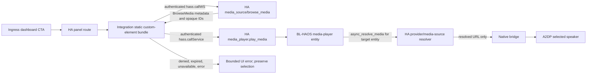

# Phase 24: HA Media Catalog & Provider Playback - Research

**Researched:** 2026-10-11
**Domain:** Home Assistant custom integration media browsing, authenticated custom panels, and native Bluetooth playback
**Confidence:** MEDIUM

**Historical baseline:** The original 2026-10-11 research below retains its 2026.9.4 URLs and version-specific claims. The approved 2026.10.3 addendum at the end governs the active target; it does not reverify the original frontend/provider/host claims.

<user_constraints>
## User Constraints (from CONTEXT.md)

### Locked Decisions

## Implementation Decisions

### HA Media Catalog (autonomous defaults)

- Browse only audio-capable media and provider playlists; this product outputs A2DP audio, not video or images.
- Preserve Home Assistant `BrowseMedia` metadata, hierarchy, `can_play`, and `can_expand`; do not flatten or reinterpret provider trees.
- Preserve a provider playlist as one HA-owned playable reference; do not expand it into BL-HAOS-managed tracks or queue state in Phase 24.
- Offer search only where Home Assistant's media source advertises it; add no provider-specific search client.

### Secure HA Frontend Boundary (autonomous defaults)

- The catalog UI must execute in a Home Assistant-authenticated frontend context with the HA-provided `hass` connection; use Home Assistant WebSocket/service APIs rather than issuing or persisting a long-lived HA token.
- Reuse the existing ingress catalog UI components and visual system, but host catalog actions in an HA-owned authenticated panel/shell. Keep the add-on's privileged REST API out of browser media-resolution paths.
- On auth loss or denied/expired access, stop the request and show a reconnect/permission error; never fall back to a stored token, direct provider API, or raw provider URL.
- UI launches the selected item through native `media_player.play_media` with the original `media-source://` ID and selected speaker entity. Home Assistant owns media resolution and passes only the resolved playback URL to the existing media-player integration.
- Before implementation, research must verify the supported Core custom-panel/WebSocket registration path and how it can reuse the existing Ingress React view without relying on private frontend internals. If no supported path can meet PL-03, stop and surface the architecture blocker rather than storing HA credentials in the add-on.

### Provider Playback and Failures (autonomous defaults)

- Home Assistant resolves provider and playlist references; BL-HAOS accepts only the resolved playable request through its existing native media-player integration.
- Keep the selection bound to one explicitly selected connected BL-HAOS media-player entity; no implicit speaker selection or multi-speaker sync.
- Unavailable, denied, expired, or unresolvable media produces a visible error and no alternate URL/provider fallback.
- Do not auto-skip or retry a different media item. Preserve the user's selected reference so Home Assistant can report or retry the same action.
- Do not log resolved URLs or credential-bearing query parameters; audit and redact the existing `async_play_media` URL debug logging as part of PL-03 security acceptance.

### the agent's Discretion

- Choose bounded loading/empty/error states and catalog navigation details that preserve existing BL-HAOS Ingress design/accessibility conventions.
- Select appropriate unit, Home Assistant integration, and browser tests after confirming the supported frontend-hosting mechanism.

### Deferred Ideas (OUT OF SCOPE)

## Deferred Ideas

- Custom BL-HAOS playlist creation/edit/reorder/delete and saved provider playlist library (Phase 25, PL-04/05/06).
- Sequential playback, queue persistence, automatic advancement, previous/next, shuffle, and repeat (Phase 26, PL-07/08/09/10).
- Direct provider API clients, provider credentials, arbitrary URL imports, and synchronized multi-speaker queues remain out of scope.
</user_constraints>

<phase_requirements>
## Phase Requirements

| ID | Description | Research Support |
|----|-------------|------------------|
| PL-01 | Each BL-HAOS media-player entity exposes supported Home Assistant audio sources and provider playlists through native Browse Media. | Existing entity delegates `async_browse_media`; filter by HA browse metadata and preserve its hierarchy. Add audio/playlist contract tests. |
| PL-02 | A supported Home Assistant media item or provider playlist selected for a connected speaker resolves through Home Assistant and starts playback on that speaker. | Core's supported `media_player.play_media` accepts the opaque original ID; the entity resolves it server-side and forwards only its URL to the bridge. |
| PL-03 | Ingress browses and launches through an authenticated HA-owned interface with no HA credentials in add-on storage or logs. | Exact Core 2026.9.4 exposes a custom-panel module URL, safe static serving, supplied `hass.callWS`, and `hass.callService`; use no bridge catalog API or browser token. |
</phase_requirements>

## Summary

Phase 24 is plan-ready. The smallest supported fail-closed architecture is an integration-owned custom element, served as a fixed-name static bundle by Home Assistant and registered by the integration at setup. The panel receives Home Assistant's authenticated `hass` object, browses via `hass.callWS({ type: "media_source/browse_media", ... })`, and invokes `hass.callService("media_player", "play_media", ...)` against exactly one selected BL-HAOS entity. This keeps provider credentials, resolution, and access control inside Home Assistant. [VERIFIED: https://developers.home-assistant.io/docs/frontend/custom-ui/creating-custom-panels/] [VERIFIED: https://raw.githubusercontent.com/home-assistant/core/2026.9.4/homeassistant/components/media_source/http.py] [VERIFIED: https://raw.githubusercontent.com/home-assistant/frontend/20260826.7/src/types.ts]

Do not add a provider SDK, a browser/add-on HA token, or a bridge proxy endpoint. The native integration already owns the appropriate handoff: it recognizes `media-source://`, calls Home Assistant `async_resolve_media` for the selected entity, processes the resulting URL for add-on reachability, and sends the resolved URL only to the native bridge. [VERIFIED: modules/integration/custom_components/bl_haos/media_player.py:368-394] [CITED: https://developers.home-assistant.io/docs/core/entity/media-player/]

**Primary recommendation:** Implement a fixed-output custom-element bundle in the HACS integration, register it with `panel_custom.async_register_panel`, use `hass.callWS` only for browse/search and `hass.callService` only for play, then explicitly remove every resolved URL from integration and bridge logs.

## Architectural Responsibility Map

| Capability | Primary Tier | Secondary Tier | Rationale |
|------------|-------------|----------------|-----------|
| Panel loading and authentication | Frontend Server (HA frontend/Core) | Browser / Client | Core serves and registers the module; the browser receives the authenticated `hass` object. |
| Catalog browse/search | Browser / Client | API / Backend (HA WebSocket) | The panel renders Core's browse tree and submits requests through the current HA session. |
| Provider catalog, credentials, and opaque reference resolution | API / Backend (Home Assistant) | Provider integration | Provider integrations remain the catalog and credential authority. |
| Targeted native playback | API / Backend (Home Assistant integration) | Bridge / Storage | HA invokes one media-player entity; integration resolves the reference before the bridge consumes the playback URL. |
| A2DP decode/process lifecycle | Bridge / Storage | Browser / Client | The bridge owns sink validation and playback processes; no browser-originated URL enters it. |
| Sensitive-log redaction | Integration and bridge backend | -- | All three URL-bearing paths must omit URL-derived values before logging. |

## Standard Stack

### Core

| Library / Core API | Version | Purpose | Why Standard |
|--------------------|---------|---------|--------------|
| Home Assistant Core `panel_custom.async_register_panel` | 2026.9.4 | Register a custom-element panel with `module_url`. | Exact Core source registers the panel through the frontend's built-in panel API. [VERIFIED: https://raw.githubusercontent.com/home-assistant/core/2026.9.4/homeassistant/components/panel_custom/__init__.py] |
| Home Assistant HTTP `StaticPathConfig` / `async_register_static_paths` | 2026.9.4 | Serve the integration-owned JavaScript bundle. | HA's developer guidance says custom integrations must use this static-path mechanism rather than custom serving. [CITED: https://developers.home-assistant.io/blog/2021-01-29-custom-integration-changes/] |
| Supplied custom-panel `hass` API | frontend `20260826.7` | Authenticated state, `callWS`, and `callService`. | The matching frontend type exposes `callWS` and `callService`; use the supplied property, not globals or frontend imports. [VERIFIED: https://raw.githubusercontent.com/home-assistant/frontend/20260826.7/src/types.ts] |
| Home Assistant media source / media player | 2026.9.4 | Browse opaque references and start targeted playback. | Core registers `media_source/browse_media`; the media-player service schema accepts `media_content_id` and `media_content_type`. [VERIFIED: https://raw.githubusercontent.com/home-assistant/core/2026.9.4/homeassistant/components/media_source/http.py] [VERIFIED: https://raw.githubusercontent.com/home-assistant/core/2026.9.4/homeassistant/components/media_player/__init__.py] |

### Supporting

| Library | Version | Purpose | When to Use |
|---------|---------|---------|-------------|
| Existing React/Vite/Tailwind/lucide bundle | Existing pinned workspace versions | Catalog presentation and shared ingress visual language. | Build a separate custom-element entry; do not reuse the ingress REST client for catalog actions. [VERIFIED: modules/bridge/web_ui/package.json:1-31] |
| `pytest-homeassistant-custom-component` | `0.13.366` current pin | Integration SIL validation. | Upgrade together with the Core pin before exercising the Core 2026.9.4 panel path. [VERIFIED: modules/integration/requirements-sil.txt:1-6] |

### Alternatives Considered

| Instead of | Could Use | Tradeoff |
|------------|-----------|----------|
| HA-owned custom panel | Ingress/bridge REST catalog proxy | Rejected: violates the HA authentication/credential boundary and the approved fail-closed gate. |
| `media_player.play_media` with original media-source ID | Browser-side `media_source/resolve_media` then raw URL | Rejected: exposes a resolved URL to browser state and bypasses the required native entity resolution path. |
| Core static registration | Custom aiohttp view or external bundle host | Rejected: HA guidance requires `async_register_static_paths`; external hosting weakens CSP/lifecycle control. |

**Installation:** No new package is justified. Existing dependencies build the panel.

## Architecture Patterns

### System Architecture Diagram



### Recommended Project Structure

```text
modules/integration/
  custom_components/bl_haos/
    __init__.py                 # panel/static lifecycle registration and unload
    media_player.py             # audio-filtered BrowseMedia and URL-free logging
    panel_static/               # packaged fixed-name panel bundle only
  panel_ui/                     # Vite/React custom-element source and build config
  tests/
    test_ha_integration_sil.py  # Core browse/play/panel registration contracts
modules/bridge/
  backend/bl_haos/api/routes.py # URL-free command logging
  backend/bl_haos/ha/player.py  # URL-free execution logging
  tests/test_api.py             # log-capture and safe native command coverage
  tests/test_media_player.py    # log-capture and process behavior
```

### Pattern 1: Register One Fixed Module Bundle Per Config Entry

**What:** During integration setup, register a static directory under a domain-owned URL and register exactly one panel whose `module_url` points to the fixed entry bundle. Register unload callbacks to remove the panel and any extra module registration made by the implementation.

**When to use:** On successful entry setup, after Core frontend/http availability is established; fail setup rather than silently rendering an unauthenticated fallback if registration fails.

**Source-supported skeleton:**

```python
from homeassistant.components import panel_custom
from homeassistant.components.http import StaticPathConfig

PANEL_URL = "/api/bl_haos/catalog/bl-haos-media-panel.js"

await hass.http.async_register_static_paths(
    [StaticPathConfig("/api/bl_haos/catalog", str(bundle_directory), cache_headers=True)]
)
await panel_custom.async_register_panel(
    hass,
    frontend_url_path="bl-haos-media",
    webcomponent_name="bl-haos-media-panel",
    module_url=PANEL_URL,
    sidebar_title="BL-HAOS Media",
    sidebar_icon="mdi:play-box-multiple",
)
```

The string values in this skeleton are proposed identifiers, not existing in-repo discrete values. [ASSUMED] The Core APIs and their `module_url`/static-path behavior are verified. [VERIFIED: https://raw.githubusercontent.com/home-assistant/core/2026.9.4/homeassistant/components/panel_custom/__init__.py] [VERIFIED: https://raw.githubusercontent.com/home-assistant/core/2026.9.4/homeassistant/components/http/server.py]

### Pattern 2: Preserve the Opaque Reference Until the Native Entity

**What:** The panel sends the selected `media_content_id` and `media_content_type` unchanged to `media_player.play_media`, targeted to one selected entity. The entity, not the panel, resolves `media-source://` and obtains the bridge-consumable URL.

**When to use:** For every playable item and provider playlist. Never call `media_source/resolve_media` from the panel in this phase.

```typescript
await hass.callService("media_player", "play_media", {
  media_content_id: selectedItem.media_content_id,
  media_content_type: selectedItem.media_content_type,
}, { entity_id: selectedTarget });
```

`media_content_id` and `media_content_type` are verified Core service fields; the variable names are illustrative. [VERIFIED: https://raw.githubusercontent.com/home-assistant/core/2026.9.4/homeassistant/components/media_player/__init__.py] [VERIFIED: https://raw.githubusercontent.com/home-assistant/frontend/20260826.7/src/types.ts]

### Pattern 3: Render the Browse Tree, Do Not Reconstruct It

**What:** Request `media_source/browse_media`, render its title/thumbnail/type/capability properties, navigate only rows with `can_expand`, and enable play only rows with `can_play` plus an available explicitly selected target. Search appears only for `can_search` sources.

**When to use:** At root, after expand, and for a source-provided search capability. Audio filtering belongs in the native integration browse path so Core Browse Media and the panel observe the same contract.

### Anti-Patterns to Avoid

- **Resolving from the panel:** `media_source/resolve_media` returns a URL and mime type; keeping that in browser state violates PL-03.
- **Bridge media-catalog endpoints:** They make the add-on a credential/media-browse proxy and bypass the HA authorization boundary.
- **Private frontend imports or globals:** Do not import HA frontend internals or reach into `window`; the supplied `hass` object is the supported boundary.
- **Dynamic hashed entry discovery without a manifest contract:** Use a deterministic panel entry name, or serve and consume a build manifest entirely from the integration; do not guess Vite output names.
- **Registering a panel per speaker:** One panel with an explicit target selector is the locked design; entity-specific browsing remains native Browse Media.

## Don't Hand-Roll

| Problem | Don't Build | Use Instead | Why |
|---------|-------------|-------------|-----|
| Provider catalog/authentication | Provider clients, OAuth/token persistence, scraping | HA media-source browse through authenticated `hass` | HA already owns provider authentication and source-specific behavior. |
| Provider resolution | URL resolver or signed-URL exchange in browser/bridge | Native `media_player.play_media` -> integration `async_resolve_media` | Prevents raw URLs and provider credentials crossing the boundary. |
| Panel routing and auth | Iframe parent bridge, copied bearer token, custom WebSocket auth | Core custom panel and injected `hass` | Session expiry and permission errors remain Core-owned. |
| Static bundle server | Custom FastAPI/aiohttp route | `hass.http.async_register_static_paths` | Official custom-integration guidance identifies this as the sole supported static-file path. |
| Browse tree normalization | Local playlist/queue/track expansion | Core `BrowseMedia` metadata | Preserves provider hierarchy and defers queue behavior to Phase 26. |

**Key insight:** the URL is intentionally a late-bound internal implementation detail. The catalog owns a `media-source://` reference, Home Assistant resolves it for the selected entity, and the bridge only receives the resulting playable stream.

## Common Pitfalls

### Pitfall 1: Exposing a resolved URL through a convenient UI shortcut

**What goes wrong:** A panel calls `media_source/resolve_media`, then logs, stores, or forwards its response. The response contains `url` and may carry time-limited authorization material. [VERIFIED: https://raw.githubusercontent.com/home-assistant/core/2026.9.4/homeassistant/components/media_source/http.py]

**How to avoid:** Browse only from the panel and call `media_player.play_media` with the original opaque ID. Assert browser persistence, DOM errors, requests to bridge routes, and logs contain no resolved URL/host/path/query/token/password.

### Pitfall 2: Logging the URL after the secure resolution boundary

**What goes wrong:** Current debug statements include the final URL in the integration, bridge API, and bridge player execution paths. [VERIFIED: modules/integration/custom_components/bl_haos/media_player.py:387-394] [VERIFIED: modules/bridge/backend/bl_haos/api/routes.py:326-330] [VERIFIED: modules/bridge/backend/bl_haos/ha/player.py:471-478]

**How to avoid:** Log operation, normalized target/entity correlation, and normalized media type only. Capture logs with a URL containing host, path, query, token, and password sentinel values, asserting every sentinel is absent.

### Pitfall 3: Filtering audio by guessing provider types

**What goes wrong:** A provider playlist can be represented by `playlist` rather than an `audio/*` content type. Filtering only MIME-like types can hide supported playlists.

**How to avoid:** Define and test a small explicit allow policy over Core browse metadata: audio-like media plus playlist, while retaining `can_expand`, `can_play`, and provider hierarchy. [ASSUMED] Confirm representative configured providers in the target HA 2026.9.4 VM before locking the filter.

### Pitfall 4: Treating successful service submission as successful playback

**What goes wrong:** `callService` completion means the service action completed, not that the external stream became audible.

**How to avoid:** Show "Starting playback" after service success, watch selected entity state for confirmation where available, and surface service/resolution errors without fallback, auto-skip, or automatic retry. [CITED: https://developers.home-assistant.io/docs/api/websocket/]

## Code Examples

### Authenticated Browse Request

```typescript
const browse = await hass.callWS({
  type: "media_source/browse_media",
  media_content_id: mediaContentId,
});
```

The Core 2026.9.4 command accepts optional `media_content_id`; the matching frontend type exposes `callWS`. [VERIFIED: https://raw.githubusercontent.com/home-assistant/core/2026.9.4/homeassistant/components/media_source/http.py] [VERIFIED: https://raw.githubusercontent.com/home-assistant/frontend/20260826.7/src/types.ts]

### URL-Free Native Resolution Boundary

```python
if is_media_source_id(media_id):
    media = await async_resolve_media(self.hass, media_id, self.entity_id)
    media_id = media.url
await self._async_command(COMMAND_PLAY_MEDIA, url=url, media_type=media_type)
```

This is the existing local flow; implementation must retain the behavior but remove URL-valued log arguments. [VERIFIED: modules/integration/custom_components/bl_haos/media_player.py:368-394]

## State of the Art

| Old Approach | Current Approach | When Changed | Impact |
|--------------|------------------|--------------|--------|
| Custom panel script (`js_url`) | ECMAScript module (`module_url`) custom panel | Current Core supports both; use module bundle | Use a modern custom element without ES5 adapter. [CITED: https://developers.home-assistant.io/docs/frontend/custom-ui/creating-custom-panels/] |
| Custom static routes | `hass.http.async_register_static_paths` | HA custom-integration guidance | Removes unsafe bespoke serving. [CITED: https://developers.home-assistant.io/blog/2021-01-29-custom-integration-changes/] |

## Project Constraints (from copilot-instructions.md)

No project-local `copilot-instructions.md` exists. Project planning rules require Home Assistant developer documentation as the first authority and require GSD workflow use for artifact edits. [VERIFIED: .planning/AGENTS.md:65-70]

## Assumptions Log

| # | Claim | Section | Risk if Wrong |
|---|-------|---------|---------------|
| A1 | A metadata allow policy can correctly distinguish all target provider audio/playlists without source-specific exceptions. | Common Pitfalls | Valid provider items could be hidden or unsupported media exposed. |
| A2 | A fixed Vite custom-element entry can be packaged alongside the HACS integration without adding a dependency. | Architecture Patterns | Build/package work may need a small toolchain adjustment. |

## Open Questions

1. **What provider metadata appears in the target HA 2026.9.4 VM?**
   - What we know: Core publishes `media_class`, `media_content_type`, `can_play`, `can_expand`, and `can_search`.
   - What's unclear: Exact provider playlist/content-type combinations for the operator's enabled integrations.
   - Recommendation: Make the first implementation verification run browse at least one configured provider playlist and one unavailable source; adjust only the documented metadata policy.

2. **Can the required HA 2026.9.4 environment run the packaged panel end to end?**
   - What we know: static serving, panel registration, media browse, and play APIs are present in exact Core source.
   - What's unclear: the current SIL dependency pin is `2026.9.3` and Windows skips the SIL suite.
   - Recommendation: Upgrade/pin SIL tooling to `2026.9.4` and validate in a Linux/WSL2 HAOS-compatible environment before accepting PL-03.

## Environment Availability

| Dependency | Required By | Available | Version | Fallback |
|------------|-------------|-----------|---------|----------|
| Node.js | Panel build/tests | Yes | `v24.19.0` | -- |
| npm | Panel build/tests | Yes | `11.17.0` | -- |
| Python | Bridge/integration tests | Yes | `3.14.7` | -- |
| Docker | HAOS/live host validation | Yes | `29.7.2` | HAOS VM remains required for true ingress validation. |
| Home Assistant SIL | native browse/resolve tests | Not runnable on native Windows | pinned `2026.9.3` | Linux/WSL2 only; upgrade to 2026.9.4. |
| Home Assistant 2026.9.4 live host | public API/panel acceptance | Not observed in this session | -- | Blocking acceptance checkpoint; no code fallback. |

**Missing dependencies with no fallback:** A running Home Assistant `2026.9.4` or compatible HAOS VM is required for final custom-panel, expired-auth, and provider access validation.

**Missing dependencies with fallback:** SIL cannot run on native Windows; run it on Linux/WSL2 as the existing test harness requires.

## Validation Architecture

### Test Framework

| Property | Value |
|----------|-------|
| Framework | pytest, pytest-asyncio, `pytest-homeassistant-custom-component`; Vitest; Playwright |
| Config file | `modules/integration/pytest.ini`, `modules/bridge/pytest.ini`, `modules/bridge/web_ui/package.json` |
| Quick run command | `./scripts/run-tests.ps1 L1` |
| Full runnable local command | `./scripts/run-tests.ps1 all` (skips HA SIL on Windows) |
| HA SIL command | Linux/WSL2: `BLHAOS_RUN_SIL=1 python -m pytest tests/test_ha_integration_sil.py -q -p asyncio --asyncio-mode=auto` |

### Phase Requirements to Test Map

| Req ID | Behavior | Test Type | Automated Command | File Exists? |
|--------|----------|-----------|-------------------|-------------|
| PL-01 | Native Browse Media exposes only audio/playlist-compatible entries while preserving hierarchy/capabilities | HA SIL | HA SIL command | Extend `modules/integration/tests/test_ha_integration_sil.py` |
| PL-02 | Selected opaque ID calls one entity and resolves/plays through HA; unavailable/unresolvable cases fail visibly | HA SIL + integration unit | HA SIL command and L1 | Extend existing SIL and media-player unit coverage |
| PL-03 | Panel registers and loads via Core; browser sends authenticated HA calls only; denied/expired cases fail closed | Live HA 2026.9.4 browser smoke + panel unit | `npm test`; host validation | Wave 0: panel test harness and HA-host smoke |
| PL-03 | URLs, query/credential sentinels absent from all three log paths | bridge/integration log-capture unit | L1 | Extend `test_api.py`, `test_media_player.py`, and integration media-player tests |

### Sampling Rate

- **Per task commit:** focused pytest/Vitest test for the touched surface.
- **Per wave merge:** `./scripts/run-tests.ps1 L1` plus `npm run build` from `modules/bridge/web_ui` when panel build changes.
- **Phase gate:** Linux/WSL2 HA SIL and manual HA 2026.9.4 panel verification including expired/denied access before `/gsd-verify-work`.

### Wave 0 Gaps

- [ ] Upgrade the SIL Core pin from `homeassistant==2026.9.3` to the requested `2026.9.4` and verify compatible test tooling.
- [ ] Add an integration panel-registration/static-path lifecycle test, including unload cleanup.
- [ ] Add a custom-element build/test entry with mocked injected `hass`; assert no `localStorage`, `sessionStorage`, bridge API client, or resolved URL path is used.
- [ ] Define a repeatable HA 2026.9.4 VM/host smoke procedure for authenticated, denied, and expired-session cases.

## Security Domain

### Applicable ASVS Categories

| ASVS Category | Applies | Standard Control |
|---------------|---------|-----------------|
| V2 Authentication | Yes | HA-injected current session; no copied/stored bearer, provider token, or alternate authentication path. |
| V3 Session Management | Yes | Stop on WebSocket/service authorization failure; no session persistence or raw URL fallback. |
| V4 Access Control | Yes | HA executes browse/service requests under the current user; target exactly one selected available BL-HAOS entity. |
| V5 Input Validation | Yes | Preserve opaque IDs at UI boundary; existing bridge validates final HTTP(S) URLs and rejects dangerous targets. |
| V6 Cryptography | No new cryptography | Rely on HA provider/session mechanisms; do not implement signing or token construction. |

### Known Threat Patterns for This Stack

| Pattern | STRIDE | Standard Mitigation |
|---------|--------|---------------------|
| Provider/HA credential leakage | Information Disclosure | No add-on/browser storage, no custom WebSocket auth, no URL-bearing logs. |
| Resolved URL exfiltration via error/log | Information Disclosure | Redact/omit all URL-derived fields; assert sentinel absence in log capture. |
| SSRF or local bridge access through playback URL | Tampering | Keep existing final URL validator and protocol whitelist; panel never supplies final URL. |
| Unauthorized panel/service use | Elevation of Privilege | Current HA session only; do not register an unauthenticated bridge catalog endpoint. |
| Expired/denied media request fallback | Repudiation / Information Disclosure | Preserve selected opaque reference, report error, and prohibit URL/provider retry/fallback. |

## Sources

### Primary

- https://developers.home-assistant.io/docs/frontend/custom-ui/creating-custom-panels/ - documented custom-element panel contract and supplied `hass` property.
- https://developers.home-assistant.io/blog/2021-01-29-custom-integration-changes/ - documented static serving mechanism for custom integrations.
- https://developers.home-assistant.io/docs/core/entity/media-player/ - documented Browse Media/media-source resolution pattern for media-player integrations.
- https://developers.home-assistant.io/docs/api/websocket/ - authenticated WebSocket command lifecycle and service-call error response behavior.
- https://raw.githubusercontent.com/home-assistant/core/2026.9.4/homeassistant/components/panel_custom/__init__.py - exact Core panel module registration path.
- https://raw.githubusercontent.com/home-assistant/core/2026.9.4/homeassistant/components/frontend/__init__.py - exact Core built-in panel and extra module APIs.
- https://raw.githubusercontent.com/home-assistant/core/2026.9.4/homeassistant/components/http/server.py - exact static-path API.
- https://raw.githubusercontent.com/home-assistant/core/2026.9.4/homeassistant/components/media_source/http.py - exact browse and resolve WebSocket command schema.
- https://raw.githubusercontent.com/home-assistant/core/2026.9.4/homeassistant/components/media_player/__init__.py - exact `play_media` service schema.
- https://raw.githubusercontent.com/home-assistant/frontend/20260826.7/src/types.ts - matching frontend `hass.callWS` and `hass.callService` types.

## Metadata

**Confidence breakdown:**
- Standard stack: HIGH - Core 2026.9.4 and matching frontend source prove the required public named APIs.
- Architecture: MEDIUM - API building blocks are verified, but the packaged panel has not run in the target HA 2026.9.4 host this session.
- Pitfalls: HIGH - existing source confirms the three URL-bearing log statements and existing Core source confirms resolver behavior.

**Research date:** 2026-10-11
**Valid until:** 2026-11-10, subject to Home Assistant Core/frontend version changes.

## Approved 2026.10.3 Rebaseline Addendum - 2026-10-24

**Decision:** The user explicitly approved moving the active phase 24 Core contract from 2026.9.4 to 2026.10.3. Original research, including the older frontend type references, is historical evidence rather than proof of the new host. No architecture or authentication fallback is authorized.

### Sources Consulted for This Rebaseline

- https://contributors.home-assistant.io/core/development/testing/ - official current Core testing guidance, fetched successfully (HTTP 200, "Running the tests").
- https://pypi.org/pypi/pytest-homeassistant-custom-component/0.13.374/json - exact helper metadata: Python `>=3.14`, `homeassistant==2026.10.3`, `pytest==9.0.3`; artifact origin `files.pythonhosted.org`.
- https://pypi.org/pypi/homeassistant/2026.10.3/json - exact Core metadata: Python `>=3.14.2`, `aiohttp==3.14.5`; artifact origin `files.pythonhosted.org`.
- https://raw.githubusercontent.com/home-assistant/core/2026.10.3/homeassistant/components/panel_custom/__init__.py - fetched HTTP 200; `async_register_panel` exposes `module_url: str | None = None`.
- https://raw.githubusercontent.com/home-assistant/core/2026.10.3/homeassistant/components/http/server.py - fetched HTTP 200; exposes `StaticPathConfig` and `async_register_static_paths`.

### Measured Compatibility and Limits

The separate Ubuntu WSL environment `/home/mse/.venvs/bl-haos-sil-2026.10.3` uses existing Python 3.14.4 and exact pins helper 0.13.374 / Core 2026.10.3 / aiohttp 3.14.5 / pytest 9.0.3. Resolver evidence required changing aiohttp from 3.14.3; pytest was preserved. Public-index dry-run and install succeeded; `pip check` found no broken requirements.

The required Linux panel/static plus integration SIL gate collected and passed all 24 tests in 4.06s, without skips or test-contract repairs. See 24-VALIDATION.md for exact commands and parent-provided RED evidence. This verifies only the exercised local runtime contracts, not every original research claim or live frontend/provider behavior.

**Still blocking:** Task 24-01-02 requires all six public-host observations on Core/HAOS 2026.10.3, including actual serving/module load, injected authenticated browse/play calls, and denied/expired rejection. No live host operation or panel implementation occurred; Plan 01 and phase acceptance remain incomplete.