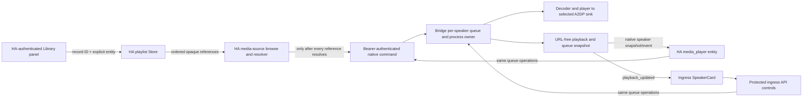

# Phase 26: Sequential Playback & Queue Controls - Research

**Researched:** 2026-10-27  
**Domain:** Home Assistant media-source resolution, per-speaker process queues, native media-player controls, and ingress playback state  
**Confidence:** MEDIUM

<user_constraints>
## User Constraints (from CONTEXT.md)

### Phase Boundary

Play saved Phase 25 custom playlists and provider shortcuts on one explicitly selected BL-HAOS speaker. The Home Assistant integration remains the media-source resolver and authenticated command gateway; the bridge owns the per-speaker playback process queue. Show active item/playlist state and provide queue controls through the existing ingress dashboard and supported native Home Assistant media-player entity.

This phase covers PL-07, PL-08, PL-09, and PL-10 only. Playlist definitions remain owned by Phase 25. Do not persist queue state across restart, synchronize queues across speakers, add provider SDKs, or claim live provider/physical playback acceptance. Work is authorized for local/mock-only progression. PL-01/02/03 remain production-pending, T-24-15 remains OPEN/HIGH, T-24-16 remains OPEN/MEDIUM, and release/deployment are blocked. Do not access a live host or provider, deploy, restart, or perform physical playback.

### Locked Decisions

- **D-26-01:** The bridge owns process sequencing and one in-memory queue per speaker. The queue is not restored after Home Assistant/add-on restart and is never synchronized across speakers; a new queue replaces only the active queue for its selected speaker.
- **D-26-02:** Home Assistant resolves every saved reference through its authenticated media-source API before queue start. Resolve the full requested playlist before replacing/starting bridge playback; if any item fails resolution, do not start a partial queue and identify the failed item. Resolved URLs exist only in the authenticated transient command and bridge memory; never persist, publish, or log them.
- **D-26-03:** Starting a saved playlist is initiated from the existing HA-authenticated media panel with exactly one connected target. Keep provider resolution and access inside Home Assistant; the panel does not receive playable URLs.
- **D-26-04:** Treat an existing single-item `media_player.play_media` request as replacement playback: cancel and clear the active queue before playing the one item. Starting another saved playlist also replaces the queue on that speaker.
- **D-26-05:** A bridge queue generation/process identity owns each completion. Ignore completions from a replaced, stopped, disconnected, or otherwise stale generation. Stop and speaker loss cancel queued work and never advance.
- **D-26-06:** Automatic advancement occurs only when the current decoder/player pair completes naturally with the bridge's accepted success exit codes. A nonzero/abnormal exit stops advancement, keeps the failed item current, and exposes a bounded failure state; never silently skip.
- **D-26-07:** `Next` is an explicit user-requested skip. `Previous` restarts the current item when its position exceeds three seconds; otherwise it selects the prior item. Neither control hides a failure without the user taking that action.
- **D-26-08:** Shuffle changes the remaining order without changing the currently playing item. Repeat modes are `off`, `one`, and `all`; repeat-one restarts the current item after successful natural completion, and repeat-all wraps at the end. Defaults are shuffle off and repeat off.
- **D-26-09:** Expose truthful current playlist, item, position/duration where available, queue length/index, shuffle/repeat mode, and error/completion status. `Play` resumes a paused current item or explicitly retries the current failed item; `Pause` and `Stop` retain their standard meanings.
- **D-26-10:** The HA-authenticated Library panel starts a saved playlist on the explicitly selected speaker and displays its current queue. The add-on ingress SpeakerCard mirrors active queue state and controls; both it and native HA media-player controls call the same bridge-owned queue. Do not add a second queue implementation in the browser.
- **D-26-11:** Extend only supported existing APIs and WebSocket/event paths. Ingress uses its existing protected add-on API path; the HA integration uses its existing bearer-authenticated native bridge client. Never pass the native bearer to browser code or expose resolved URLs in queue snapshots/events.
- **D-26-12:** Advertise native `NEXT_TRACK`, `PREVIOUS_TRACK`, `SHUFFLE_SET`, and `REPEAT_SET` features only when the bridge queue contract is available, alongside current play/pause/stop controls. All controls operate on the same queue session as ingress.
- **D-26-13:** Queue and player errors use bounded status copy. Resolution failure occurs before queue replacement; process failure retains the failed item; no automatic retry, auto-skip, or alternate speaker occurs.

### the agent's Discretion

- Select the exact bridge request/response fields, queue-state version, and native event representation after inspecting current API compatibility and test patterns.
- Choose concise queue labels, empty/completed state copy, and accessible control grouping consistent with the existing Neumorphic ingress and HA panel.
- Use deterministic fake process and mock-HA seams; do not install dependencies unless an existing requirement proves insufficient.

### Deferred Ideas (OUT OF SCOPE)

- Queue restoration across restart (PL-12) and synchronized multi-speaker queues (PL-13).
- Live Home Assistant/provider acceptance, deployment, actual audible playback, and release approval; these remain separately gated.
- New provider integrations, raw URL imports, automatic skip/retry, and queue persistence.
</user_constraints>

<phase_requirements>
## Phase Requirements

| ID | Description | Research Support |
|----|-------------|------------------|
| PL-07 | Starting a saved playlist on a selected speaker plays its items in order and advances only after the current item completes successfully. | Bridge-owned per-speaker queue, HA resolve-all-before-replace orchestration, natural-success process classification, and stale-generation guard. |
| PL-08 | Users can view the active playlist and item, and control playback with next, previous, shuffle, repeat, play, pause, and stop in the ingress UI and supported native Home Assistant controls. | One sanitized queue snapshot shared through the existing playback envelope; native feature gating and ingress actions map to the same bridge commands. |
| PL-09 | Stop, replacement playback, or speaker loss cancels queued work so late process-completion events cannot advance a stale playlist. | Invalidate the per-speaker queue generation before teardown; preserve process-pair identity checks and cover disconnect/replacement races. |
| PL-10 | Media resolution or playback failures expose an explicit state and do not silently skip the failed item. | HA returns bounded per-reference resolution errors before queue replacement; bridge retains the failed current item with a bounded failure classification and no auto-retry/skip. |
</phase_requirements>

## Summary

The current architecture already has the right ownership boundary but only for one media item: HA resolves `media-source://` identifiers in `BLHAOSMediaPlayer.async_play_media`, the integration submits one URL through its bearer-authenticated client, and `MediaPlayerBridge` owns the decoder/player pair and publishes timeline state. The saved library is a separate HA-owned Store containing ordered references; provider shortcuts deliberately remain one opaque reference. There is no queue command, queue snapshot, queue control, or queue-specific test today. [VERIFIED: current integration and bridge sources](modules/integration/custom_components/bl_haos/media_player.py#L435-L475) [VERIFIED: playlist library](modules/integration/custom_components/bl_haos/playlist_library.py#L421-L475) [VERIFIED: native command schema](modules/bridge/backend/bl_haos/api/routes.py#L170-L218)

**Primary recommendation:** implement one transient queue state machine per speaker in the bridge; add an HA-authenticated start orchestration that loads the saved record and resolves every reference before submitting one bounded batch; publish a URL-free queue snapshot through the existing playback envelope; and route native and ingress controls to that same bridge state machine. Do not implement queue advancement in React or use repeated browser `play_media` calls. [VERIFIED: the current panel sends a single media-player service call](modules/integration/panel_ui/src/media-panel.tsx#L840-L880) [VERIFIED: shared playback envelope and event path](modules/bridge/backend/bl_haos/api/routes.py#L204-L218) [VERIFIED: event fan-out](modules/bridge/backend/bl_haos/main.py#L215-L240)

**Planning decision resolved:** provider shortcuts launch as one atomic queue item. Phase 25 stores one opaque reference and does not expand tracks; `async_resolve_media` resolves one media-source ID to one `PlayMedia` result and does not establish a provider track sequence. Queue index/next/previous therefore operate over custom playlist entries or the saved-library item sequence, never a provider's internal tracks. [VERIFIED: `async_play_media` resolves one ID](modules/integration/custom_components/bl_haos/media_player.py#L435-L470) [VERIFIED: provider save preserves one opaque reference](modules/integration/custom_components/bl_haos/playlist_library.py#L421-L475) [DECIDED: 26-CONTEXT D-26-14]

**Assumption-delta decision:** the primary identity remains normalized speaker address (`no-change`); the playback state value is promoted from one process pair to a per-speaker playback session that owns the queue generation and current process pair. This generalizes the existing per-speaker lifecycle without introducing a second speaker identity. [VERIFIED: `active_processes` is keyed by address](modules/bridge/backend/bl_haos/ha/player.py#L241-L246) [DECIDED: 26-CONTEXT D-26-15]

## Architectural Responsibility Map

| Capability | Primary Tier | Secondary Tier | Rationale |
|------------|-------------|----------------|-----------|
| Playlist lookup and media-source resolution | API / Backend (Home Assistant integration) | Database / Storage (HA Store) | HA owns the persistent reference library, provider authorization, and resolver; only the integration has the authenticated HA and native bridge client contexts. |
| Queue sequencing and decoder/player lifecycle | API / Backend (bridge) | — | The bridge owns process pairs and completion watchers; queue advancement must survive a closed browser tab and reject stale process completions. |
| Native HA playback controls and current-media metadata | API / Backend (HA integration entity) | API / Backend (bridge state) | The entity maps HA feature methods to the native client and projects the bridge snapshot. |
| Ingress queue display and controls | Browser / Client | API / Backend (protected add-on API and WebSocket) | The card should render the same bridge snapshot and issue commands; it must not own an order or retain resolved media URLs. |
| Queue persistence | — | — | Explicitly out of scope; queue/process state is memory-only and is cleared by restart. |

## Standard Stack

### Core

| Existing component | Version / contract | Purpose | Why it is the standard |
|--------------------|--------------------|---------|------------------------|
| Home Assistant Core media-source and media-player APIs | SIL pin: Core 2026.10.3 | Resolve stored references, expose entity controls, and retain HA as provider/auth boundary. | Phase 24/25 already use `async_resolve_media`, `async_process_play_media_url`, injected HA `callWS`/`callService`, and pinned Core SIL. |
| BL-HAOS bridge `MediaPlayerBridge` | Existing native API contract version 1; queue contract not yet present | Own per-speaker process pair, timeline, serialization, and new transient queue state. | Existing process creation and watcher are already in the bridge; extending the owner avoids browser-owned playback sequencing. |
| Existing HA integration client and native transport | Existing command and bridge identity version 1; capability negotiation absent | Carry authenticated commands and playback snapshots between HA and bridge. | Bearer remains in HA config-entry client and is never exposed to panel JavaScript. |
| Existing React ingress and HA media panel | React 18.2.0; TypeScript 5.2.2 | Start playlists in the HA shell; render and control queue state in the ingress SpeakerCard. | Both surfaces already exist and have isolated component/mock-browser test seams. |

Verbatim existing declarations grounding those discrete contracts:

```python
# modules/bridge/backend/bl_haos/constants.py
NATIVE_BRIDGE_VERSION = 1
NATIVE_COMMAND_VERSION = 1

# modules/bridge/backend/bl_haos/api/routes.py
operation: Literal["play", "pause", "stop", "set_volume", "play_media"]

# modules/integration/custom_components/bl_haos/media_player.py
_attr_supported_features = (
  MediaPlayerEntityFeature.PLAY
  | MediaPlayerEntityFeature.PAUSE
  | MediaPlayerEntityFeature.STOP
  | MediaPlayerEntityFeature.VOLUME_SET
  | MediaPlayerEntityFeature.PLAY_MEDIA
  | MediaPlayerEntityFeature.BROWSE_MEDIA
)

# modules/integration/panel_ui/package.json
"react": "18.2.0",
"@playwright/test": "1.63.0",
"typescript": "5.2.2",
"vitest": "5.0.4"

# modules/bridge/backend/requirements-test.txt
pytest==9.0.3
pytest-asyncio==1.4.0
```

[VERIFIED: bridge contract values](modules/bridge/backend/bl_haos/constants.py#L46-L47) [VERIFIED: current native operation allowlist](modules/bridge/backend/bl_haos/api/routes.py#L170-L180) [VERIFIED: current native feature declaration](modules/integration/custom_components/bl_haos/media_player.py#L252-L259) [VERIFIED: frontend/test versions](modules/integration/panel_ui/package.json#L17-L31) [VERIFIED: pytest versions](modules/bridge/backend/requirements-test.txt#L1-L4) [VERIFIED: exact SIL pins](.planning/STATE.md#L63-L63)

### Supporting test stack

| Component | Existing version | Use |
|-----------|------------------|-----|
| Bridge pytest / pytest-asyncio | pytest 9.0.3 / pytest-asyncio 1.4.0 | Fake subprocesses and bridge/API behavior. |
| Home Assistant SIL | Core 2026.10.3; pytest-homeassistant-custom-component 0.13.374; aiohttp 3.14.5 | Resolver, authenticated WebSocket, native client, entity feature, and failure-boundary tests in WSL. |
| Panel Vitest / Playwright | Vitest 5.0.4 / Playwright 1.63.0 | Component control mapping and origin-restricted deterministic mock acceptance. |

The exact versions above are already present in the panel manifest, bridge test requirements, and recorded Phase 24/25 SIL configuration. No new runtime or test package is indicated; package installation and the package-legitimacy gate are not applicable. [VERIFIED: panel manifest](modules/integration/panel_ui/package.json#L1-L37) [VERIFIED: bridge test pins](modules/bridge/backend/requirements-test.txt#L1-L6) [VERIFIED: phase SIL pins](.planning/STATE.md#L63-L63)

### Alternatives Considered

| Instead of | Could use | Tradeoff |
|------------|-----------|----------|
| Bridge-owned per-speaker queue | Browser-driven sequential `play_media` requests | Browser sequencing stops when the tab closes, can race user commands, and cannot own decoder completion. It conflicts with D-26-01/D-26-10. |
| HA resolution before one queue start | Persist resolved URLs in the library or ask the browser to resolve them | Persisted URLs expire and can contain access signatures; browser resolution violates the HA auth boundary. |
| Extend playback state/event envelope | Separate queue state machine in the integration and ingress | Duplicated queue state would drift and permit native and ingress commands to operate on different items. |

## Architecture Patterns

### System Architecture Diagram

The new queue-start WebSocket operation and queue command fields below are a recommended contract, not existing APIs. [ASSUMED]



### Recommended Project Structure

Keep the implementation within the existing ownership boundaries; the listed files are current homes, not a requirement to add a queue subsystem package.

```text
modules/bridge/backend/bl_haos/ha/player.py              # in-memory queue, generation, process completion
modules/bridge/backend/bl_haos/api/routes.py             # bounded native command/snapshot contract
modules/bridge/backend/bl_haos/main.py                   # disconnect invalidation and dual event fan-out
modules/integration/custom_components/bl_haos/media_player.py  # HA feature methods and one-item replacement
modules/integration/custom_components/bl_haos/client.py  # native capability, commands, cached snapshots
modules/integration/custom_components/bl_haos/playlist_library.py # HA-authenticated saved-record start handler or adjacent integration-owned handler
modules/integration/panel_ui/src/media-panel.tsx         # selected target and saved-playlist launch
modules/bridge/web_ui/src/api/client.ts                   # typed playback/queue snapshot and protected controls
modules/bridge/web_ui/src/hooks/useBluetoothEvents.ts     # queue snapshot event merge
modules/bridge/web_ui/src/components/SpeakerCard.tsx      # queue status and controls
```

### Pattern 1: Resolve Everything, Then Replace

**What:** Load the authoritative saved record in HA, preserve its ordered opaque references, resolve each reference through HA, normalize each resulting URL with Core's media URL processing, and submit one bounded queue-start command only after all resolutions succeed. Recheck that the explicit target entity is still available before submitting. If any resolution fails, return a bounded item-specific error without sending a bridge command or replacing the current queue. [VERIFIED: current resolver and target checks](modules/integration/custom_components/bl_haos/media_player.py#L435-L475) [VERIFIED: resolution failures already fail closed](modules/integration/tests/test_ha_integration_sil.py#L756-L824)

```python
# Existing HA resolver pattern; queue-start orchestration must apply it to
# every saved reference before sending any bridge command.
media = await async_resolve_media(self.hass, media_id, self.entity_id)
url = async_process_play_media_url(self.hass, media.url)
```

**When to use:** Any launch from the saved library. Do not move resolution into the bridge or panel. The bridge should receive only the transient, bounded playable URL batch and display metadata, not media-source IDs as a substitute for provider resolution. [VERIFIED: project media-source boundary](.planning/research/V1.0-PLAYLIST-STACK.md#L1-L16)

### Pattern 2: Per-Speaker Generation Fencing

**What:** Keep a current queue generation/session identity per speaker. Every queue worker and process watcher captures it. Replacement, stop, disconnect, and shutdown synchronously invalidate the current generation before process teardown; a completion may update state or advance only if its generation and process pair still own that speaker. [VERIFIED: existing process-pair identity fence](modules/bridge/backend/bl_haos/ha/player.py#L1474-L1488) [VERIFIED: disconnect event currently schedules stop](modules/bridge/backend/bl_haos/main.py#L263-L277)

**When to use:** Every queue transition and any operation that can replace/stop a process. Do not expose the internal generation token as a URL-bearing or user-facing queue field; the public snapshot needs only enough stable state for clients to render and reconcile.

### Pattern 3: One URL-Free Snapshot for Both Clients

**What:** Extend `playback_envelope` with an allowlisted queue summary and reuse it for the authenticated native speaker record and the ingress playback-updated event. Extend the integration speaker cache and ingress `PlaybackInfo` model with the same sanitized fields. Keep only the HA media title/playlist label, position/duration, index/count, repeat/shuffle, and bounded state/error; never serialize queue URLs or raw exception messages. [VERIFIED: shared native/ingress envelope](modules/bridge/backend/bl_haos/api/routes.py#L204-L267) [VERIFIED: ingress event patch point](modules/bridge/backend/bl_haos/main.py#L215-L240) [VERIFIED: browser snapshot model](modules/bridge/web_ui/src/api/client.ts#L52-L93)

## Queue Design Recommendations

### 1. Ownership and Lifecycle

- Store one active in-memory queue object per normalized speaker address in `MediaPlayerBridge`; include the playlist label, sanitized display metadata, ordered current/future items, index/history needed for previous, repeat/shuffle settings, queue status, current generation, and current process pair. Never write it to HA Store or add-on config. [VERIFIED: current bridge state is per address](modules/bridge/backend/bl_haos/ha/player.py#L241-L278) [VERIFIED: HA Store owns only playlist library data](modules/integration/custom_components/bl_haos/playlist_library.py#L265-L292)
- Do not hold a per-speaker lock while awaiting process completion. Serialize queue mutations and process replacement with the address lock, but let the watcher wait outside the lock and reacquire it only for a generation-checked transition. Refactor toward a private already-locked play primitive if the queue runner must start items under the lock: today `play_url()` takes `_address_lock`, while `execute()`'s play/pause/stop paths do not consistently take it. Avoid calling the public locking `play_url()` from a path that already holds that lock. [VERIFIED: `play_url` locks](modules/bridge/backend/bl_haos/ha/player.py#L568-L580) [VERIFIED: control dispatch](modules/bridge/backend/bl_haos/ha/player.py#L495-L542)
- For a playlist start, HA resolves all references first; only then does the bridge invalidate/replace the selected speaker's old queue and start item zero. For an existing single-item `play_media`, keep the current one-attempt behavior, invalidate the old queue, and clear queued tail/history before single-item playback. Do not affect other speakers. [VERIFIED: single-item command currently receives one URL](modules/integration/custom_components/bl_haos/client.py#L211-L245) [VERIFIED: per-address active process storage](modules/bridge/backend/bl_haos/ha/player.py#L241-L250)
- Stop, replacement, speaker loss, and bridge shutdown must invalidate the generation before asynchronous process stop/reap can yield. Main currently schedules `execute(..., COMMAND_STOP)` after a BlueZ disconnect event; add synchronous queue invalidation at detection time so a just-finished process cannot advance before the scheduled stop runs. [VERIFIED: BlueZ loss schedules stop with `_spawn`](modules/bridge/backend/bl_haos/main.py#L263-L277) [VERIFIED: bounded process teardown removes current pair first](modules/bridge/backend/bl_haos/ha/player.py#L1360-L1410)
- At end-of-queue with repeat off, retain a sanitized completed snapshot until explicit replacement/stop; on failure retain the failed current item and queue settings. Clear remaining resolved URLs on stop/replacement/end as soon as no longer needed. Queue state is not restored after restart; existing `async_shutdown()` stops active processes. [VERIFIED: shutdown stops current process pairs](modules/bridge/backend/bl_haos/ha/player.py#L1498-L1510)

### 2. Saved References and Transient URLs

- Custom records supply `entries[]` in saved order; each entry has an opaque `media_content_id` and display snapshot. Resolve each through `async_resolve_media(hass, media_content_id, entity_id)`, pass the resolved URL through `async_process_play_media_url`, and allow the bridge's existing URL validator to remain the final transport boundary. Keep title/artist from allowed metadata or resolved media where available; do not use the URL as the display identity. [VERIFIED: entry shape and validation](modules/integration/custom_components/bl_haos/playlist_library.py#L50-L70) [VERIFIED: current resolver path](modules/integration/custom_components/bl_haos/media_player.py#L435-L475) [VERIFIED: bridge URL validation](modules/bridge/backend/bl_haos/ha/player.py#L568-L590)
- The panel should submit a saved record ID and one explicitly selected entity ID to a new HA-authenticated queue-start handler. That handler reads the canonical HA Store record, resolves all references, and submits one native authenticated command through `BLHAOSClient`; it must not return resolved URLs to `media-panel.tsx`. Keep the exact handler placement and message schema as an implementation-plan choice. [VERIFIED: current panel already uses authenticated `hass.callWS`](modules/integration/panel_ui/src/media-panel.tsx#L61-L72) [VERIFIED: global library commands are registered at HA setup](modules/integration/custom_components/bl_haos/playlist_library.py#L840-L860) [VERIFIED: client owns bearer headers](modules/integration/custom_components/bl_haos/client.py#L112-L125)
- Require a connected explicit target before resolution and recheck availability after asynchronous resolution, matching the existing single-item flow. Full resolution failure must make zero native commands and leave the currently playing queue untouched. Existing SIL tests already cover resolver failure, invalid results, target unavailable, target disconnect during resolution, and no retry; extend those assertions to multiple items and existing-queue preservation. [VERIFIED: current target and resolution guards](modules/integration/custom_components/bl_haos/media_player.py#L435-L475) [VERIFIED: resolver and target failure tests](modules/integration/tests/test_ha_integration_sil.py#L756-L919)
- A queue-start command is larger and more sensitive than the current single URL command. Apply explicit item-count, per-URL, aggregate-byte, metadata, and operation-ID limits before replacing a queue. Reuse Phase 25's existing custom-entry ceiling as the initial playlist-count bound unless queue transport tests justify a smaller limit; derive aggregate bounds from the current API body/URL contract rather than assuming the maximum library record is a safe HTTP batch. The source declares `MAX_CUSTOM_ENTRIES = 250`. [VERIFIED: Phase 25 limit declaration](modules/integration/custom_components/bl_haos/playlist_library.py#L25-L28) [ASSUMED: queue batch limits require a new explicit bridge contract]

**Provider shortcut boundary:** provider shortcuts are atomic HA-owned media items. The queue will not claim track-level controls inside a provider playlist; the user sees the shortcut as one item and HA/provider playback owns its contents. This avoids an unsupported Browse-expansion assumption and preserves Phase 25's opaque reference contract. [VERIFIED: provider record stays atomic](modules/integration/custom_components/bl_haos/playlist_library.py#L421-L475) [DECIDED: 26-CONTEXT D-26-14]

### 3. Natural Completion, Failure, Cancellation, and Stale Generations

- Treat completion as successful only after both decoder and player have exited through the explicitly accepted natural-success set, and only if the queue generation and process pair still match. Start with a strict success-only policy; do not equate “not abnormal for logging” with “safe to advance.” [VERIFIED: current watcher uses a broader logging predicate](modules/bridge/backend/bl_haos/ha/player.py#L1474-L1488)
- The existing watcher contains this predicate: `is_abnormal = (player.returncode not in (0, None)) or (decoder.returncode not in (0, None, -15, 255))`. It always clears timeline and moves to idle afterward; it has no queue failure status. Do not reuse `-15`/`255` allowances as natural completion success: stop/replacement may terminate a process, and an abnormal exit must retain the current item and report failure. The exact accepted success codes should be pinned by fake-process tests before auto-advance is enabled. [VERIFIED: exact current predicate and state transition](modules/bridge/backend/bl_haos/ha/player.py#L1474-L1488)
- Stop/replacement invalidates queue ownership before process termination; the current `_stop_processes` removes the active process pair before signaling, and `_watch_processes` already compares the pair before mutating state. Preserve both protections and add a monotonic/session generation so callbacks from an old queue cannot affect a new queue even if the state no longer has the old pair. [VERIFIED: stop removes process ownership](modules/bridge/backend/bl_haos/ha/player.py#L1360-L1385) [VERIFIED: process-pair check](modules/bridge/backend/bl_haos/ha/player.py#L1474-L1488)
- Distinguish outcomes by cause rather than exit code alone: natural success can advance; expected user stop, replacement, disconnect, and shutdown are cancellation and never advance; nonzero/abnormal natural completion is failure and never advances. Represent queue `completed`, `stopped`, `failed`, and `unavailable` as bounded queue status separate from HA's player state (`idle`, `playing`, `paused`, or `off`). [VERIFIED: entity currently exposes only HA idle/playing/paused for connected playback and off when disconnected](modules/integration/custom_components/bl_haos/media_player.py#L286-L310) [ASSUMED: the proposed queue-status vocabulary is new]
- The native route currently auto-reconnects a missing sink with `reset_existing=True` and retries the same operation. That behavior conflicts with D-26-13's no-auto-retry/no-replacement semantics for queue commands. Exclude queue start/advance/next/previous from this recovery branch, or revise it so the command returns a bounded failure without reissuing a non-idempotent queue action. Keep this explicit in the route plan and tests. [VERIFIED: sink recovery and operation retry](modules/bridge/backend/bl_haos/api/routes.py#L376-L426)
- The client currently retries every command except `play_media` after a dropped HTTP acknowledgment. `next`, `previous`, and queue start are non-idempotent under that policy and could skip/restart twice. Make them single-attempt and reconcile with the next snapshot, or add a deduplication ID to the bridge command contract; do not rely on the current generic retry default. [VERIFIED: retry count selection and rationale](modules/integration/custom_components/bl_haos/client.py#L211-L245)

### 4. Native HA and Ingress Controls Share the Queue

- Extend the native request operation allowlist and validated payload for queue start, next/previous, shuffle/repeat, and queue-aware play/pause/stop. The bridge operation is authoritative; HA entity methods and ingress API routes are adapters only. The current request is limited to five operations and `play_media` URL fields. [VERIFIED: exact current request allowlist](modules/bridge/backend/bl_haos/api/routes.py#L170-L202)
- Current entity features are exactly:

  ```python
  _attr_supported_features = (
      MediaPlayerEntityFeature.PLAY
      | MediaPlayerEntityFeature.PAUSE
      | MediaPlayerEntityFeature.STOP
      | MediaPlayerEntityFeature.VOLUME_SET
      | MediaPlayerEntityFeature.PLAY_MEDIA
      | MediaPlayerEntityFeature.BROWSE_MEDIA
  )
  ```

  D-26-12 requires the four queue feature flags conditionally. Add an explicit queue-capability/version to bridge identity or trusted speaker snapshot and have the integration cache it. The current identity handshake checks the bridge ID but does not gate features on a queue capability, so do not advertise controls merely because the integration code is newer. [VERIFIED: existing feature declaration](modules/integration/custom_components/bl_haos/media_player.py#L252-L259) [VERIFIED: identity handshake](modules/integration/custom_components/bl_haos/client.py#L124-L148) [VERIFIED: current identity response](modules/bridge/backend/bl_haos/api/routes.py#L306-L320)
- The current state mapping is exactly `valid_states = {MediaPlayerState.IDLE, MediaPlayerState.PLAYING, MediaPlayerState.PAUSED}` and returns `MediaPlayerState.OFF` when the speaker is disconnected. Project the current item as `media_title`, playlist label as HA playlist metadata, and timing through existing media position/duration properties; expose queue length/index/modes/status/error as bounded attributes or the playback snapshot. Never replace HA's standard entity state with custom queue lifecycle states. [VERIFIED: entity state values and mapping](modules/integration/custom_components/bl_haos/media_player.py#L286-L305) [VERIFIED: current timeline properties](modules/integration/custom_components/bl_haos/media_player.py#L314-L352) [ASSUMED: current Core async method names and feature servicing should be confirmed by pinned Core SIL]
- The Library view currently has create/edit/delete and provider shortcut management but no launch action; its explicit target selector currently appears in Browse view only. Add a connected-target selector and play action in the authenticated Library view. Preserve the selected connected entity check and session-generation guards. [VERIFIED: current Library actions](modules/integration/panel_ui/src/media-panel.tsx#L940-L1060) [VERIFIED: Browse target selector and play action](modules/integration/panel_ui/src/media-panel.tsx#L840-L925)
- Ingress `SpeakerCard` currently has volume, connect/disconnect, remove, and settings actions, but no playback controls. Add a queue panel to the card for status/current playlist/item/timeline and controls; use the existing protected add-on API route family and WebSocket event, never the native bearer. [VERIFIED: current SpeakerCard action surface](modules/bridge/web_ui/src/components/SpeakerCard.tsx#L1-L225) [VERIFIED: ingress client and playback snapshot types](modules/bridge/web_ui/src/api/client.ts#L52-L93) [VERIFIED: playback event merge](modules/bridge/web_ui/src/hooks/useBluetoothEvents.ts#L98-L110)
- The add-on's `playback_envelope` is already reused by native speaker snapshots and ingress `playback_updated`; extend that one contract rather than introducing a queue-only event stream. On native HA updates, the current client processes `speaker_updated` and caches the speaker record, so queue metadata added under `playback` reaches entity listeners through the existing path. [VERIFIED: bridge dual publication](modules/bridge/backend/bl_haos/main.py#L215-L240) [VERIFIED: native client speaker event processing](modules/integration/custom_components/bl_haos/client.py#L418-L449)

### 5. Repeat, Shuffle, and Previous Semantics

- Use locked modes `off`, `one`, and `all`, defaults off/off. Repeat-one restarts the same current item only after successful natural completion; repeat-all wraps after the final item; any failure stops, regardless of repeat mode. A user pressing Next is an explicit skip, including from a failed item; automatic advancement never skips. [VERIFIED: locked repeat/shuffle decisions](.planning/phases/26-sequential-playback-queue-controls/26-CONTEXT.md#L39-L47)
- Keep the current item fixed when enabling shuffle; shuffle only the not-yet-played tail. Maintain playback history separately from the randomized future order so Previous remains coherent after shuffle changes. Inject a seeded/fake RNG in tests rather than making ordering assertions nondeterministic. [ASSUMED: history representation and RNG injection are implementation choices]
- Previous follows the locked three-second rule: beyond the threshold restart the current item; otherwise select the prior item. The context does not define behavior at index zero or after completion. Recommended default: at index zero, restart the current item instead of wrapping; only wrap Previous under repeat-all if the plan deliberately selects symmetric cyclic semantics. Add a clear test and UI disabled/label behavior for the selected contract. [VERIFIED: locked threshold and intent](.planning/phases/26-sequential-playback-queue-controls/26-CONTEXT.md#L33-L38) [ASSUMED: boundary behavior recommendation]
- `Play` resumes a paused process pair and explicitly retries the current failed item; retry must not happen automatically. `Pause` freezes queue position and process timeline; `Stop` invalidates the queue and clears queued work. Ensure queue controls do not degrade into replaying `last_urls` from a stopped session. [VERIFIED: existing play/pause/stop process behavior](modules/bridge/backend/bl_haos/ha/player.py#L495-L542) [VERIFIED: locked queue control semantics](.planning/phases/26-sequential-playback-queue-controls/26-CONTEXT.md#L43-L50)

### 6. Concrete Test Architecture

| Layer | Existing home | Focused queue coverage |
|-------|--------------|------------------------|
| Bridge process/queue unit | `modules/bridge/tests/test_media_player.py` | Fake decoder/player pairs; both-success advance; either-child failure retains current item; stop/replacement/disconnect generation invalidation; stale watcher after replacement; pause/resume; repeat modes; seeded shuffle; previous threshold/boundary; bounded teardown; shutdown clears queue; no URL in snapshot/log. |
| Bridge API contract | `modules/bridge/tests/test_api.py`, `test_native_transport.py` | Queue operation schema, bounds/allowlist, auth/trusted-sink checks, capability negotiation, URL-free speaker snapshot/events, no duplicated non-idempotent command after ambiguous acknowledgment, and no queue auto-reconnect retry. |
| HA integration SIL | `modules/integration/tests/test_ha_integration_sil.py`, `test_playlist_library_sil.py` | Core Store lookup; exact ordered IDs; resolver called for each entry with selected entity; all-or-nothing failure leaves bridge command and prior queue untouched; URL normalization and URL redaction; entity next/previous/shuffle/repeat/play/pause/stop maps to bridge; target disconnect before submit; capability-based native features; queue snapshot updates. Run in pinned WSL Core 2026.10.3 environment. |
| HA panel component | `modules/integration/panel_ui/src/playlist-library.test.tsx` and/or existing `media-panel.test.tsx` | Library target selection, launch response/errors, no playable URL returned to panel, session-generation guard, pending/failure states, disabled disconnected target, queue status display. |
| Ingress component and mock browser | Add focused tests in existing Vitest files and `modules/bridge/web_ui` UI tests if present; extend `modules/integration/panel_ui/e2e/playlist-library.spec.ts` only for HA panel workflow | Deterministic API/event model; all controls call the same mocked command seam; state updates from snapshot/event; 375/768/1440 layouts; keyboard/focus; origin restriction and assertion that no native bearer, provider URL, or live-host call occurs. |

Do not add a new broad E2E framework. The retired Docker integration suite is not the path; module-local SIL/unit/mock-browser tests are the local gate, while actual HAOS VM/provider/audio validation remains separately authorized. Phase 25's final local verifier reports 42 Core SIL tests, 68 panel Vitest tests, and 17 mock Playwright tests passing; those are prior-scope baselines, not Phase 26 queue evidence. [VERIFIED: Phase 25 verification](.planning/phases/25-saved-playlist-library/25-VERIFICATION.md#L115-L150) [VERIFIED: retired integration-test skill](.github/skills/update-e2e-tests/SKILL.md#L1-L13)

## Don't Hand-Roll

| Problem | Don't Build | Use Instead | Why |
|---------|-------------|-------------|-----|
| Provider auth and media URL resolution | Provider clients, token storage, browser URL resolution | HA `async_resolve_media` and `async_process_play_media_url` in the integration | Preserves the existing HA media-source boundary and signed/relative URL handling. |
| Queue ownership | React queue arrays and browser timers | One in-memory per-speaker bridge queue and process watcher | Queue must continue without the tab and be governed by process completion. |
| Duplicate queue protocol state | Separate native and ingress state models | Existing playback envelope and speaker update event, extended with sanitized queue state | Current native and ingress channels already share the bridge playback projection. |
| Process teardown | New ad hoc `terminate()`/unbounded waits | Existing bounded `_stop_processes`/reaper lifecycle, extended with generation invalidation | Existing teardown handles paused and wedged children with bounded waits. |

**Key insight:** the queue is a process-lifecycle feature, not a UI playlist widget. The frontend submits intent and renders authoritative snapshots; HA resolves identity and authorization; only the bridge decides whether a process completion owns the next transition. [VERIFIED: current process watcher and event ownership](modules/bridge/backend/bl_haos/ha/player.py#L1360-L1410) [VERIFIED: frontend currently has no queue transport](modules/bridge/web_ui/src/components/SpeakerCard.tsx#L1-L225)

## Common Pitfalls

### Pitfall 1: Advancing on “watcher returned”

**What goes wrong:** stop, replacement, or a failing decoder is mistaken for natural completion and the next item starts.  
**Why it happens:** current `_watch_processes` only computes a warning predicate, then always clears timeline and sets idle. The predicate also tolerates decoder return codes beyond zero for logging.  
**How to avoid:** require accepted natural-success codes for both children plus matching queue generation and process identity; classify cancellation separately from failure.  
**Warning signs:** an error/stop test observes the next item's process factory called, or completion changes the new queue's item. [VERIFIED: current watcher behavior](modules/bridge/backend/bl_haos/ha/player.py#L1474-L1488)

### Pitfall 2: Hidden replay from transport recovery

**What goes wrong:** a failed queue operation reconnects and is reissued, potentially replaying a start or skipping twice.  
**Why it happens:** the native route has an automatic sink recovery/retry path, and the integration client retries most commands after a dropped acknowledgment.  
**How to avoid:** mark queue start/next/previous as non-retryable or deduplicate by operation ID; exclude them from route auto-reconnect retry; reconcile uncertain outcomes from a later authoritative snapshot.  
**Warning signs:** one UI click increments the bridge operation count more than once or starts a queue after the UI reported failure. [VERIFIED: route retry](modules/bridge/backend/bl_haos/api/routes.py#L376-L426) [VERIFIED: client retry policy](modules/integration/custom_components/bl_haos/client.py#L211-L245)

### Pitfall 3: Deadlock while queueing process starts

**What goes wrong:** queue worker holds the address lock and calls `play_url()`, which tries to acquire the same non-reentrant lock.  
**Why it happens:** `play_url` locks, while execute control methods do not consistently serialize.  
**How to avoid:** define one lock ownership policy; provide a private `_play_url_locked` call for already-locked queue transitions and never wait for the full process lifetime under the lock.  
**Warning signs:** queue starts hang after process teardown or `wait_for` expires in a fake-process test. [VERIFIED: current lock boundaries](modules/bridge/backend/bl_haos/ha/player.py#L495-L542) [VERIFIED: URL start lock](modules/bridge/backend/bl_haos/ha/player.py#L568-L580)

### Pitfall 4: Treating a provider shortcut as multiple queue entries

**What goes wrong:** the implementation expands a saved provider shortcut into BL-HAOS-owned per-track queue entries or claims provider-internal next/previous behavior the bridge cannot observe.  
**Why it happens:** Phase 25 stores one opaque HA-owned playlist reference; HA/provider owns the playlist contents.  
**How to avoid:** this phase treats the shortcut as one atomic queue item and resolves it once through HA. Provider track expansion is explicitly opted out in `COVERAGE.md`; do not browse for children or copy provider entries. Queue index/next/previous apply to the saved-library item sequence and custom playlist entries only.  
**Warning signs:** a provider shortcut creates multiple bridge queue entries or UI labels imply track-level control inside the provider playlist. [VERIFIED: provider shortcut contract](modules/integration/custom_components/bl_haos/playlist_library.py#L421-L475) [VERIFIED: Phase 24 decision](.planning/phases/24-ha-media-catalog-provider-playback/24-CONTEXT.md#L24-L41) [DECIDED: 26-CONTEXT D-26-14]

### Pitfall 5: Capability mismatch across add-on and integration versions

**What goes wrong:** new integration advertises queue controls to an older bridge that rejects the operations, or a client retries a non-idempotent operation when the acknowledgment is lost.  
**Why it happens:** bridge identity currently reports a bridge version but no feature capability; the integration checks identity but does not store a queue-capability flag.  
**How to avoid:** negotiate an explicit queue contract capability/version and enable native flags only after the bridge advertises it; preserve existing single-item operations for older bridge versions.  
**Warning signs:** controls appear enabled while native commands return unsupported-operation errors. [VERIFIED: bridge identity contract](modules/bridge/backend/bl_haos/api/routes.py#L306-L320) [VERIFIED: integration identity check](modules/integration/custom_components/bl_haos/client.py#L124-L148)

## Project Constraints (from copilot-instructions.md)

- No workspace-root `copilot-instructions.md` was found during discovery. `.planning/AGENTS.md` says to consult official Home Assistant developer documentation for HA integration/API decisions and to follow the patterns already present in the repository. [VERIFIED: project planning instructions](.planning/AGENTS.md#L1-L34)
- `.planning/config.json` has Nyquist validation and security enforcement enabled. Its `security_block_on: critical` value is temporary and local-only; STATE directs restoration to `high` before live verification, release, or deployment. Do not interpret the temporary threshold as risk acceptance. [VERIFIED: planning config](.planning/config.json#L18-L42) [VERIFIED: STATE scope note](.planning/STATE.md#L68-L73)
- Current execution is local/mock-only and has an explicit no-stage/no-commit override. `commit_docs` is false. Do not create commits, update release metadata, access live HA/provider, deploy, restart, or play physical media. [VERIFIED: STATE](.planning/STATE.md#L1-L10) [VERIFIED: Phase 25 context override](.planning/phases/25-saved-playlist-library/25-CONTEXT.md#L12-L18) [VERIFIED: planning config](.planning/config.json#L1-L8)
- Phase 25's canonical local verification is passed, but STATE/ROADMAP still describe final verification as pending. Treat Phase 25 as locally/mock verified for planning dependencies only; do not promote production requirement or release status, and do not reconcile STATE/ROADMAP as part of this research task. [VERIFIED: Phase 25 verification](.planning/phases/25-saved-playlist-library/25-VERIFICATION.md#L1-L8) [VERIFIED: stale STATE status](.planning/STATE.md#L1-L34) [VERIFIED: roadmap Phase 25 status](.planning/ROADMAP.md#L163-L188)

## Security Domain

Security enforcement is enabled. T-24-15 remains OPEN/HIGH for real-session leakage and attested-expiry evidence; T-24-16 remains OPEN/MEDIUM for production provider, physical audio, HA-shell visual, and accessibility acceptance. The local mock exception does not close either finding or authorize release. [VERIFIED: Phase 24 security register](.planning/phases/24-ha-media-catalog-provider-playback/24-SECURITY.md#L55-L60) [VERIFIED: current STATE](.planning/STATE.md#L68-L83)

### Applicable ASVS Categories

| ASVS Category | Applies | Standard Control |
|---------------|---------|-----------------|
| V2 Authentication | Yes | HA authenticated WebSocket for panel start; existing bearer-authenticated native bridge client; never expose bearer to the browser. |
| V3 Session Management | Yes | Reuse injected HA connection/session guards; invalidate async UI requests on HA session replacement; queue itself is transient and not restored. |
| V4 Access Control | Yes | One explicitly selected connected `media_player` target; bridge route rechecks trusted audio sink; do not substitute another speaker. |
| V5 Input Validation | Yes | Validate record ID, entity ID, bounded item count/aggregate payload, metadata, repeat/shuffle values, and every resolved URL before queue replacement. |
| V6 Cryptography | Yes, for transport/secrets | Reuse the existing native bearer boundary and trusted transport assumptions; do not invent crypto or expose signed URLs. Phase 24's HTTP transport caveat remains open; this phase does not accept or resolve it. |

### Known Threat Patterns

| Pattern | STRIDE | Standard Mitigation |
|---------|--------|---------------------|
| Resolved URL or signed query leaks into browser/event/log | Information Disclosure | Queue snapshots/logging use allowlisted metadata only; unit tests seed sentinel URL/query values and assert absence. |
| Retried next/previous or queue-start after lost acknowledgment | Tampering / Replay | Single-attempt dispatch or command-ID deduplication; reconcile from snapshots. |
| Stale watcher advances replacement queue | Tampering | Monotonic generation plus process-pair ownership check at every completion. |
| Forged target or untrusted sink | Elevation of Privilege | HA checks the explicit connected entity; bridge native route rechecks bearer, trust, and audio-sink status. |
| Oversized batch or pathological playlist | Denial of Service | Bounded playlist count, per-field lengths, aggregate request bytes, bounded event/error payloads. |

## Assumptions Log

| # | Claim | Section | Risk if Wrong |
|---|-------|---------|---------------|
| A1 | Provider playlist contents are not expanded by this phase; shortcut launch is an atomic HA-resolved item. | Saved References | No provider-owned track list is represented in the BL-HAOS queue. |
| A2 | The standard HA async method names for the locked native feature flags map to the expected entity handlers on Core 2026.10.3; Phase 26 SIL must prove the exact calls before advertising them. | Native Controls | A mismatch causes Home Assistant actions to be absent or fail. |
| A3 | At queue index zero, Previous should restart the current item rather than wrap unless repeat-all cyclic semantics are explicitly selected. | Repeat/Shuffle | User-visible navigation differs at the first track. |
| A4 | Queue start/next/previous need either single-attempt semantics or server-side request deduplication because the present client retries most commands. | Lifecycle/Transport | An ambiguous acknowledgment could cause duplicate starts or skips. |
| A5 | Queue capability is additive and explicitly negotiated; legacy single-item transport remains supported. | Native Controls | Resolved in planning; feature fields and compatibility tests are specified in Plan 26-02. |
| A6 | The strict natural-success set should initially be zero-only for both decoder and player unless deterministic tests demonstrate another normal exit code. | Completion | Incorrect classification either blocks legitimate advancement or skips on failure/cancellation. |

## Resolved Planning Questions

1. **[RESOLVED] Queue-start handler ownership:** Load saved records and resolve references through a namespaced HA-authenticated WebSocket command registered with the installation-wide playlist library; submit the resolved batch through the selected entity's existing native client. Do not return URLs to the panel.
2. **[RESOLVED] Mixed-version contract:** Keep current native API/identity version compatibility and add an explicit additive queue capability/contract version. Gate native features and queue requests on that capability; keep legacy single-item playback supported.
3. **[RESOLVED] Failure and completed HA projection:** Keep bounded queue lifecycle status separate from HA's standard `idle`/`playing`/`paused`/`off` state; retain failed current item and queue until explicit user action.
4. **[RESOLVED] Previous at first item:** Restart the current item at index zero; do not wrap backward, including repeat-all.

## Environment Availability

| Dependency | Required By | Available | Version | Fallback |
|------------|-------------|-----------|---------|----------|
| Node.js | Panel tests/build | Yes | v24.19.0 | None needed. |
| npm | Panel tests/build | Yes | 11.17.0 | None needed. |
| WSL Ubuntu SIL environment | Integration tests against Core | Previously verified in Phase 24/25 | Python 3.14.4; Core 2026.10.3 | Native Windows skips SIL; use the documented WSL venv. |
| Home Assistant host/provider/Bluetooth speaker | Production acceptance only | Not accessed and not authorized | — | Use deterministic SIL and mock browser for local phase gate; live acceptance remains separately blocked. |

No live service is required for implementation or local validation. The WSL package path was locally inspected but no tests or HA process were run in this research pass. [VERIFIED: local Node/npm version probes] [VERIFIED: Phase 24/25 WSL test evidence](.planning/phases/25-saved-playlist-library/25-VERIFICATION.md#L115-L150) [VERIFIED: user scope](.planning/phases/26-sequential-playback-queue-controls/26-CONTEXT.md#L5-L13)

## Validation Architecture

Nyquist validation is enabled. The following commands are the recommended narrow gates; no Phase 26 tests exist yet. [VERIFIED: planning config](.planning/config.json#L18-L33)

### Test Framework

| Property | Value |
|----------|-------|
| Framework | pytest 9.0.3 / pytest-asyncio 1.4.0; Home Assistant Core SIL 2026.10.3; Vitest 5.0.4; Playwright 1.63.0 |
| Config files | `modules/bridge/pytest.ini`, `modules/integration/pytest.ini`, `modules/integration/panel_ui/vitest.config.ts`, `modules/integration/panel_ui/playwright.mock.config.ts` |
| Quick bridge command | `python -m pytest tests/test_media_player.py -q` from `modules/bridge` |
| Quick integration command | `BLHAOS_RUN_SIL=1 python -m pytest tests/test_ha_integration_sil.py -q -p asyncio --asyncio-mode=auto -k 'playlist or queue or play_media'` from `modules/integration` in the pinned WSL venv |
| Quick panel command | `npm --prefix modules/integration/panel_ui test -- --run src/playlist-library.test.tsx` |
| Full local suite | Bridge module tests; pinned WSL integration SIL and unit tests; panel Vitest and `npm --prefix modules/integration/panel_ui run test:mock-panel` |

### Phase Requirements → Test Map

| Req ID | Behavior | Test Type | Automated Command | File Exists? |
|--------|----------|-----------|-------------------|-------------|
| PL-07 | Ordered queue starts and only successful natural completion advances | Bridge unit + HA SIL | Focused `test_media_player.py` and new queue selectors in `test_ha_integration_sil.py` | Existing files; new tests Wave 0 |
| PL-08 | Shared queue controls and current metadata in native HA and ingress | API/entity + Vitest + mock Playwright | `pytest tests/test_api.py tests/test_native_transport.py`; panel Vitest and `test:mock-panel` | Existing files; new assertions Wave 0 |
| PL-09 | Stop/replacement/disconnect cancels; stale generation cannot advance | Bridge unit + route/SIL + mock event tests | `pytest tests/test_media_player.py -k 'queue or watcher or stop'` and focused integration selector | Existing bridge tests; new queue tests Wave 0 |
| PL-10 | Resolver/process failures visible and retained without auto-skip | HA SIL + bridge unit + panel tests | Existing resolver failure tests extended to multi-entry; focused queue failure selectors | Existing files; new multi-entry tests Wave 0 |

### Sampling Rate

- **Per task:** run the touched bridge or panel slice; run the pinned SIL selector for resolver/command/entity changes.
- **Per wave:** run bridge playback/API tests, complete playlist SIL and panel Vitest, then deterministic mock Playwright.
- **Phase gate:** all local suites green; no live HA/provider/audio claim. Actual HAOS VM/provider/audio acceptance remains separately gated and cannot be substituted by mock evidence.

### Wave 0 Gaps

- [ ] Bridge queue success/failure/generation tests in `modules/bridge/tests/test_media_player.py`.
- [ ] Native queue request/capability/snapshot tests in `modules/bridge/tests/test_api.py` and `test_native_transport.py`.
- [ ] Core 2026.10.3 SIL for multi-reference resolve-before-replace, queue controls, feature gating, and URL non-disclosure in `modules/integration/tests/test_ha_integration_sil.py`.
- [ ] Panel launch/control component tests and a deterministic queue model/event path in the existing mock harness; no real-host Playwright in this authorized scope.
- [ ] No framework or package install is needed.

## State of the Art

| Existing approach | Phase 26 approach | Impact |
|-------------------|------------------|--------|
| One URL per `play_media`; enqueue rejected | One HA-resolved, bounded transient queue-start batch; single item still replaces | All saved references resolve before queue replacement; the bridge owns advancement. |
| Process watcher clears to idle after any completed pair | Generation-fenced success/failure/cancel/completed queue status | Only natural success advances; abnormal completion retains the current failure. |
| Native entity advertises basic playback and browse only | Queue features are conditional on negotiated bridge capability | Old bridge versions do not advertise unsupported queue actions. |
| Playback envelope exposes state/volume/timeline | Same envelope carries sanitized queue summary | Native and ingress clients render the same authoritative queue. |

## Sources

### Primary (HIGH confidence)

- [Phase 26 context](.planning/phases/26-sequential-playback-queue-controls/26-CONTEXT.md) - locked ownership, resolution, completion, control, and scope decisions.
- [Phase 24 context](.planning/phases/24-ha-media-catalog-provider-playback/24-CONTEXT.md), [Phase 24 verification](.planning/phases/24-ha-media-catalog-provider-playback/24-VERIFICATION.md), and [Phase 24 security register](.planning/phases/24-ha-media-catalog-provider-playback/24-SECURITY.md) - HA auth boundary, local-mock authority, open T-24 threats.
- [Phase 25 context](.planning/phases/25-saved-playlist-library/25-CONTEXT.md), [Phase 25 verification](.planning/phases/25-saved-playlist-library/25-VERIFICATION.md), and summaries 25-01 through 25-07 - durable record contract and current test baseline.
- Current entity, native client, playlist manager, bridge player/routes/events, ingress card/API/hooks, and their module-local tests, cited inline above.

### Secondary (LOW confidence)

- [Home Assistant media player entity documentation](https://contributors.home-assistant.io/core/entities/media-player/) - consulted for feature-gated native controls, media metadata, and media-source flow. The configured research confidence classifier rated the webfetch result LOW; verify exact method dispatch and feature behavior in the pinned Core 2026.10.3 SIL suite before relying on it.

## Metadata

**Confidence breakdown:**
- Queue ownership and current code paths: HIGH - directly inspected source and Phase 26 locked decisions.
- HA/provider saved-reference expansion: MEDIUM - the current atomic shortcut schema is verified; provider child enumeration is not established.
- Native feature method compatibility: MEDIUM - flags are locked by Phase 26; exact Core dispatch remains a SIL verification item.
- Test architecture: HIGH - existing module-local tests and Phase 25 verification were inspected.

**Research date:** 2026-10-27  
**Valid until:** 2026-11-26 for stable architecture; recheck Core/media-source behavior against the pinned version when planning implementation.