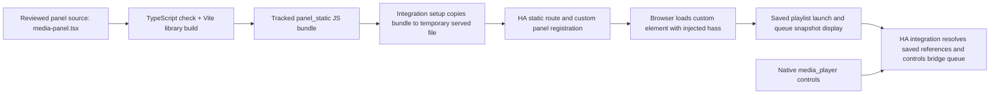

# Phase 28: Package Panel Bundle Parity - Research

**Researched:** 2026-10-28  
**Domain:** Home Assistant custom integration frontend bundling and package verification  
**Confidence:** MEDIUM

## User Constraints

- Local build/package verification only. No deployment, publication, host changes, Home Assistant Core restart, or physical playback.
- Research only; do not generate the phase plan.
- Do not edit application code or the existing `panel_static` artifact, and do not commit. Preserve all existing dirty worktree changes. [USER REQUEST; `.planning/STATE.md:97`]

<phase_requirements>
## Phase Requirements

| ID | Description | Research Support |
|----|-------------|------------------|
| PRD-01 | "The Home Assistant integration package serves a generated panel bundle built from the reviewed panel source, and package-layout checks verify the queue launch and control UI is present." [VERIFIED: `.planning/REQUIREMENTS.md:50`] | Build from `panel_ui/src/media-panel.tsx`; compare a fresh Vite output against the tracked package artifact; strengthen package-layout checks for queue launch/summary markers; retain local Core SIL coverage for the serving route. |
</phase_requirements>

## Summary

The source-to-package path is already configured: the integration panel source is `modules/integration/panel_ui/src/media-panel.tsx`; Vite library mode writes the generated module directly to `modules/integration/custom_components/bl_haos/panel_static/bl-haos-media-panel.js`; integration setup copies that artifact to a temporary file and serves it at the registered module URL. [VERIFIED: `modules/integration/panel_ui/vite.config.ts:8-15`; `modules/integration/custom_components/bl_haos/__init__.py:26-29,65-69,93-106`]

The packaged file is stale relative to current source. Source contains saved-playlist launch and the `Playback queue` summary, while a read-only marker search of the tracked artifact found the older `Your playlists` library but none of the queue-summary/launch markers. The existing package-layout test passed despite this mismatch because it checks artifact existence and generic component/theme strings, not source-to-bundle parity. [VERIFIED: `modules/integration/panel_ui/src/media-panel.tsx:933,1053-1066,1086-1092`; `modules/integration/custom_components/bl_haos/panel_static/bl-haos-media-panel.js:6103-6104`; `modules/integration/tests/test_package_layout.py:116-129`; local test run]

**Primary recommendation:** Keep the existing pinned Vite/TypeScript toolchain. Build into a fresh temporary output directory and byte-compare the expected single JS file with the tracked `panel_static` file; separately keep package-layout and SIL tests for package inclusion and Home Assistant serving behavior. Do not run the normal build until the current dirty panel-source diff is intentionally accepted as the reviewed build input. [VERIFIED: `modules/integration/panel_ui/vite.config.ts:8-15`; local Vite CLI help; `git -C modules/integration status --short`]

## Architectural Responsibility Map

| Capability | Primary Tier | Secondary Tier | Rationale |
|------------|-------------|----------------|-----------|
| Panel rendering, saved-playlist launch, queue summary | Browser / Client | Home Assistant integration | The React custom element uses the injected `hass` object and sends the saved-record launch through Home Assistant WebSocket APIs. [VERIFIED: `modules/integration/panel_ui/src/media-panel.tsx:99,933-945,1053-1066,1086-1092`] |
| Bundle generation and package inclusion | Build / package | — | Vite creates the static module at the integration's packaged asset path. [VERIFIED: `modules/integration/panel_ui/vite.config.ts:8-15`] |
| Static module serving and panel registration | Home Assistant integration | Browser / Client | Integration setup copies the packaged file to a temporary served path, registers it through `StaticPathConfig`, then registers the custom panel. [VERIFIED: `modules/integration/custom_components/bl_haos/__init__.py:65-69,93-107`] |
| Next/previous/shuffle/repeat controls | Home Assistant integration entity | Home Assistant frontend | The entity advertises and implements these controls; the React panel component shows queue state and launch actions, not those transport buttons. [VERIFIED: `modules/integration/custom_components/bl_haos/media_player.py:307-312,515-537`; `modules/integration/panel_ui/src/media-panel.tsx:1053-1092`] |

## Standard Stack

### Core

| Library / tool | Version | Purpose | Why Standard |
|----------------|---------|---------|--------------|
| Node.js / npm | Local: 24.19.0 / 11.17.0 | Run the panel build and tests | Verified in the current Windows environment. The existing CI Node 22 job is scoped to `modules/bridge/web_ui`, not this integration panel, so it does not establish a panel runtime pin. [VERIFIED: local `node --version`, `npm --version`; `.github/workflows/tests.yml:108-132`] |
| TypeScript | 5.2.2 | Type-check panel source during build | Exact version in the panel package manifest/lockfile. [VERIFIED: `modules/integration/panel_ui/package.json:27-31`] |
| Vite | 7.3.7 | Produce the ES library bundle | Existing local config selects library mode and the fixed output path/name. [VERIFIED: `modules/integration/panel_ui/package.json:27-31`; `modules/integration/panel_ui/vite.config.ts:8-15`] |
| React / React DOM | 18.2.0 | Render the custom element UI | Existing pinned panel runtime dependencies. [VERIFIED: `modules/integration/panel_ui/package.json:14-18`] |
| Vitest | 5.0.4 | Run source-level panel tests | Existing package script is `vitest run`; current panel suite passed 73 tests. [VERIFIED: `modules/integration/panel_ui/package.json:7-9,27-31`; local test run] |

### Supporting

| Library | Version | Purpose | When to Use |
|---------|---------|---------|-------------|
| `@vitejs/plugin-react` | 4.7.0 | React transform for Vite | Existing build plugin. [VERIFIED: `modules/integration/panel_ui/package.json:20-25`; `modules/integration/panel_ui/vite.config.ts:1-4`] |
| `@testing-library/react` | 16.3.3 | User-facing component assertions | Existing source tests. [VERIFIED: `modules/integration/panel_ui/package.json:20-25`] |
| `pytest-homeassistant-custom-component` | 0.13.374 | In-process Home Assistant SIL | Use for the static-route/panel lifecycle contract, not live-host acceptance. [VERIFIED: `modules/integration/requirements-sil.txt:3-6`; WSL SIL run] |

**Installation / build commands:** The integration README instructs running `npm ci` and `npm run build` from `panel_ui`; the root testing guide also documents `npm --prefix modules/integration/panel_ui test` and `npm --prefix modules/integration/panel_ui run build`. [VERIFIED: `modules/integration/README.md:84-86`; `TESTING.md:87-90`]

```powershell
npm --prefix modules/integration/panel_ui test
npm --prefix modules/integration/panel_ui run build
```

The build command writes to the tracked package artifact and clears its configured output directory. It was intentionally not run during this research. [VERIFIED: `modules/integration/panel_ui/vite.config.ts:8-9`; user constraint]

## Package Legitimacy Audit

No new external package is needed for Phase 28; the existing panel manifest and lockfile provide the build/test toolchain. No package was installed during this research. [VERIFIED: `modules/integration/panel_ui/package.json`; `modules/integration/panel_ui/package-lock.json:1-30`; local `npm ls --depth=0`]

## Architecture Patterns

### System Architecture Diagram



The panel registration code owns a shared entry lifecycle: it copies the packaged JS, registers the static route once, and registers the panel; final unload removes the temporary file and panel while reusing the inert route. Local Core SIL tests cover this lifecycle. [VERIFIED: `modules/integration/custom_components/bl_haos/__init__.py:65-107`; `modules/integration/tests/test_panel_registration.py:77-116`]

### Recommended Project Structure

```text
modules/integration/
  panel_ui/
    src/media-panel.tsx                 # Reviewed React custom element
    src/media-panel.test.tsx             # Queue launch, selected target, snapshot tests
    package.json                         # Exact scripts and direct dependency pins
    package-lock.json                    # Reproducible dependency graph
    vite.config.ts                       # Source entry and package output contract
  custom_components/bl_haos/
    __init__.py                          # Static copy and panel registration lifecycle
    panel_static/bl-haos-media-panel.js  # Tracked generated integration asset
  tests/
    test_package_layout.py               # Static package assertions; parity gap is here
    test_panel_registration.py           # Core SIL static serving/lifecycle assertions
```

### Pattern 1: Compare a fresh isolated build to the packaged file

**What:** Type-check and build the existing Vite library to a newly created temporary output directory, assert the directory contains only `bl-haos-media-panel.js`, then compare that output byte-for-byte with the tracked artifact. The installed Vite CLI accepts `build --outDir <dir>`; Vite documents `build.outDir` as configurable. [VERIFIED: local Vite 7.3.7 `build --help`; [CITED: https://vite.dev/config/build-options#build-outdir]]

**When to use:** The parity check must fail when `panel_static` is stale without first replacing the file being checked. Use a fresh temporary directory because the repository config sets `emptyOutDir: true`. [VERIFIED: `modules/integration/panel_ui/vite.config.ts:8-9`]

**Implementation target:** Add this check to the existing `test_package_layout.py` or a package script invoked by it. Keep the existing normal build command for an intentional bundle update; do not make a test silently regenerate the tracked file before asserting parity. [VERIFIED: `modules/integration/tests/test_package_layout.py:116-129`; `modules/integration/panel_ui/package.json:7`]

### Queue UI Boundary

The source has a `Playback queue` summary and `Play playlist` buttons; source tests cover launching a saved record to one explicitly selected connected speaker, confirmation before replacing an active queue, and rendering only that speaker's queue snapshot. [VERIFIED: `modules/integration/panel_ui/src/media-panel.tsx:1053-1092`; `modules/integration/panel_ui/src/media-panel.test.tsx:83-190`]

The panel source does not implement next/previous/shuffle/repeat/play/pause/stop buttons. The integration entity exposes native queue-control features and methods instead. Treat "queue-control UI" as the panel's launch and queue-summary UI unless the phase owner explicitly expands scope. [VERIFIED: `modules/integration/custom_components/bl_haos/media_player.py:307-312,515-537`; `modules/integration/panel_ui/src/media-panel.tsx:1053-1092`]

### Anti-Patterns to Avoid

- Building directly over `panel_static` merely to test freshness: the Vite config has `emptyOutDir: true`, so this overwrites the evidence and can remove unexpected files in that directory. [VERIFIED: `modules/integration/panel_ui/vite.config.ts:8-9`]
- Treating file existence or generic strings as parity: the current package-layout test passed while queue markers were absent from the package. [VERIFIED: `modules/integration/tests/test_package_layout.py:116-129`; local test run and marker search]
- Treating a panel Vitest pass as proof that Home Assistant serves the current bundle: unit tests exercise source; the static-route lifecycle is a distinct integration boundary. [VERIFIED: `modules/integration/panel_ui/vitest.config.ts:5-10`; `modules/integration/tests/test_panel_registration.py:77-116`]
- Adding direct transport controls to this panel without confirming scope; the native entity is the existing owner for next/previous/shuffle/repeat. [VERIFIED: `modules/integration/custom_components/bl_haos/media_player.py:307-312,515-537`]

## Don't Hand-Roll

| Problem | Don't Build | Use Instead | Why |
|---------|-------------|-------------|-----|
| TSX/React production bundling | Custom concatenation or minification script | Existing Vite library build | The local configuration already defines the entry, ES format, fixed filename, inline dynamic imports, and package output directory. [VERIFIED: `modules/integration/panel_ui/vite.config.ts:8-15`] |
| Home Assistant custom panel registration | Private router manipulation or a second static server | Existing `panel_custom` and `StaticPathConfig` integration lifecycle | The local SIL tests validate the public registration and unload/reload behavior. [VERIFIED: `modules/integration/custom_components/bl_haos/__init__.py:93-107`; `modules/integration/tests/test_panel_registration.py:35-116`] |
| Artifact freshness | Marker-only checks as a proxy for generated parity | Fresh temporary build plus exact comparison | Marker checks do not prove source-to-output equality and currently miss the stale bundle. [VERIFIED: `modules/integration/tests/test_package_layout.py:116-129`; local test run] |

**Key insight:** Generation and verification are separate gates. `npm run build` regenerates the packaged artifact; a parity test must compare a fresh isolated output against that artifact before any overwrite. [VERIFIED: `modules/integration/panel_ui/package.json:7`; `modules/integration/panel_ui/vite.config.ts:8-9`]

## Common Pitfalls

### Pitfall 1: Build masks the drift it should detect
**What goes wrong:** Running the ordinary build before checking the checked-in artifact replaces the stale file, so a subsequent marker test cannot report that the package was out of date.  
**How to avoid:** Build to a fresh temporary directory and compare exact bytes; reserve the normal output path for the intentional artifact refresh. [VERIFIED: `modules/integration/panel_ui/vite.config.ts:8-9`; local Vite CLI help]

### Pitfall 2: Unreviewed source is packaged
**What goes wrong:** The integration worktree currently has uncommitted changes to `panel_ui/src/media-panel.tsx` and `media-panel.test.tsx`; rebuilding would incorporate those source edits. The generated bundle itself is currently clean/tracked.  
**How to avoid:** Preserve the existing changes and confirm they are the reviewed source intended for Phase 28 before generating the committed package asset. Do not reset, stage, or commit them as part of research. [VERIFIED: `git -C modules/integration status --short`; `git -C modules/integration diff -- panel_ui/src/media-panel.tsx panel_ui/src/media-panel.test.tsx custom_components/bl_haos/panel_static/bl-haos-media-panel.js`]

### Pitfall 3: Existing static test gives a false green
**What goes wrong:** `test_panel_build_source_and_stable_bundle_contract` checks source existence, build script, output file existence, one-file directory layout, and generic bundle markers; it does not compare the fresh build to the stored artifact or assert saved-playlist launch/queue UI. It passed in the present stale state.  
**How to avoid:** Extend this existing test surface with an exact parity assertion and targeted queue UI markers in the packaged or freshly compared output. [VERIFIED: `modules/integration/tests/test_package_layout.py:116-129`; local run: 1 passed]

### Pitfall 4: Native Windows pytest loads the SIL plugin
**What goes wrong:** The default Windows venv auto-loads `pytest-homeassistant-custom-component`, which imports Core's Unix-only `fcntl` and fails before the static package test is collected.  
**How to avoid:** For the isolated static test, set `PYTEST_DISABLE_PLUGIN_AUTOLOAD=1`; for panel registration/SIL, use the configured Ubuntu WSL environment. The documented WSL panel-registration suite passed 26 tests. [VERIFIED: `TESTING.md:57,87-90`; Windows failure and successful retry; WSL SIL run]

## Code Examples

Current documented local commands, from the repository root:

```powershell
npm --prefix modules/integration/panel_ui test
npm --prefix modules/integration/panel_ui run build
```

The first command was run and passed 73 tests. The second is the intentional generated-artifact write and was not run. [VERIFIED: `TESTING.md:89-90`; local command results]

For the freshness test, use Vite's output-directory override only with a unique, empty temporary directory, then compare the output to the packaged asset; do not target the tracked `panel_static` path for the test. [VERIFIED: local Vite CLI help; `modules/integration/panel_ui/vite.config.ts:8-9`; [CITED: https://vite.dev/config/build-options#build-outdir]]

## State of the Art

| Earlier state | Current intended approach | Impact |
|---------------|---------------------------|--------|
| A checked-in `panel_static` asset can lag the tested TSX source. | Treat it as generated output and fail a check when a fresh isolated build differs. | Package parity becomes a repeatable local assertion rather than a manual visual/string check. [VERIFIED: `.planning/ROADMAP.md:300-307`; `modules/integration/tests/test_package_layout.py:116-129`] |
| Generic bundle markers establish only that some panel bundle exists. | Test source build identity, queue launch/summary presence, and package serving separately. | Prevents false green when a stale bundle remains loadable. [VERIFIED: local test run and artifact marker search; `modules/integration/tests/test_panel_registration.py:77-116`] |

## Assumptions Log

| # | Claim | Section | Risk if Wrong |
|---|-------|---------|---------------|
| A1 | "Queue-control UI" for PRD-01 means saved-playlist launch plus queue status/summary in this panel; next/previous/shuffle/repeat remain native Home Assistant media-player controls. [ASSUMED] | Queue UI Boundary | Wrong interpretation could omit requested controls or pull unrelated UI into the package-parity phase. |
| A2 | A byte-for-byte build comparison is stable when run with the same locked package graph and selected Node/npm runtime. [ASSUMED] | Pattern 1 | If environment differences affect minification/output, parity could flap; standardize the panel build runtime before adding the gate. |

## Open Questions

1. **What exactly counts as "queue-control UI" in PRD-01?** Current panel source has the Play action and queue snapshot/status; native media-player controls implement next/previous/shuffle/repeat. Planning should preserve this boundary unless the requirement owner explicitly asks for direct panel transport controls.
2. **Which Node/npm versions should be the reproducible panel build standard?** The local environment is Node 24.19.0/npm 11.17.0. The existing workflow's Node 22 build is scoped to `modules/bridge/web_ui`, so it is not evidence that the integration panel has a pinned/validated CI runtime. [VERIFIED: `.github/workflows/tests.yml:108-132`; local version checks]

## Environment Availability

| Dependency | Required By | Available | Version | Fallback |
|------------|------------|-----------|---------|----------|
| Node.js | Panel build/tests | Yes | 24.19.0 | Use a project-selected supported Node runtime |
| npm | Locked panel dependencies/scripts | Yes | 11.17.0 | None needed locally |
| Panel npm dependencies | Build and Vitest | Yes | Direct dependencies installed from lockfile | `npm ci` from `panel_ui` if a clean install is needed |
| Python / pytest on Windows | Static package-layout test | Yes | Python 3.14.7 / pytest 9.0.3 | Disable pytest plugin autoload for this static test |
| Ubuntu WSL2 HA SIL environment | Panel static-serving lifecycle | Yes | Python 3.14.4 / Core 2026.10.3 | Linux CI; native Windows is not supported for this SIL suite |

**Missing dependencies with no fallback:** None identified. [VERIFIED: local version/dependency checks; WSL test run; `TESTING.md:57,87-90`]

## Validation Architecture

Nyquist validation is enabled. Security enforcement is enabled at ASVS level 1. [VERIFIED: `.planning/config.json:24,48-49`]

### Test Framework

| Property | Value |
|----------|-------|
| Panel unit framework | Vitest 5.0.4 with jsdom; `modules/integration/panel_ui/vitest.config.ts` |
| Package/layout framework | pytest; `modules/integration/tests/test_package_layout.py` |
| HA registration framework | Home Assistant SIL via pytest; `modules/integration/tests/test_panel_registration.py` |
| Quick source command | `npm --prefix modules/integration/panel_ui test` |
| Focused package command | `$env:PYTEST_DISABLE_PLUGIN_AUTOLOAD='1'; .\\.venv\\Scripts\\python.exe -m pytest modules/integration/tests/test_package_layout.py::test_panel_build_source_and_stable_bundle_contract -q` |
| Full relevant gate | Panel unit tests + fresh temporary build parity test + package-layout tests + WSL panel-registration SIL. No existing single command currently combines the parity check. |

### Phase Requirements -> Test Map

| Req ID | Behavior | Test Type | Automated Command | File Exists? |
|--------|----------|-----------|-------------------|-------------|
| PRD-01 | Build the reviewed TSX source and fail when the tracked bundle differs | Build/parity | Proposed: add `test_panel_bundle_matches_fresh_build` to `test_package_layout.py`; run with the focused pytest command above. It must build to a temp `--outDir`, assert only the expected JS file, and compare bytes. | No; Wave 0 |
| PRD-01 | Package contains saved playlist launch and queue summary UI | Package-layout | Covered by the fresh-build comparison plus explicit `Playback queue` / `Play playlist` assertions. | Partial; current test only checks generic markers |
| PRD-01 | Integration serves the package at its registered module URL and removes served file on unload | HA SIL | `wsl.exe -d Ubuntu --cd /mnt/f/Workspace/BL-HAOS/modules/integration env BLHAOS_RUN_SIL=1 PYTHONDONTWRITEBYTECODE=1 /home/mse/.venvs/bl-haos-sil-2026.10.3/bin/python -m pytest tests/test_panel_registration.py -q -p asyncio --asyncio-mode=auto --tb=short --show-capture=no` | Yes; 26 passed locally |
| PRD-01 | Saved launch and selected-speaker queue snapshot behavior remains intact in source | Unit | `npm --prefix modules/integration/panel_ui test` | Yes; 73 passed locally |

### Sampling Rate

- **Per task:** Run the narrowest modified Vitest or focused package-layout test.
- **Per wave:** Run the fresh-build parity check and full panel Vitest suite.
- **Phase gate:** Run package-layout assertions and the local WSL panel-registration SIL after the reviewed bundle is refreshed. Do not substitute live HA-host validation; it is outside this phase's authorization. [VERIFIED: user constraints; `.planning/ROADMAP.md:300-307`]

### Wave 0 Gaps

- [ ] Add a deterministic fresh-build-vs-tracked-bundle test, ideally in the existing `test_package_layout.py`; current coverage does not detect stale generated output.
- [ ] Add package assertions for the queue-summary and saved-launch markers to make PRD-01 behavior obvious at the package boundary.
- [ ] Record the selected Node/npm runtime for this package; current CI Node 22 coverage is for the Bridge web UI, not this panel.

## Security Domain

### Applicable ASVS Categories

| ASVS Category | Applies | Standard Control |
|---------------|---------|------------------|
| V2 Authentication | Yes | Continue to use the authenticated Home Assistant-injected `hass` APIs; do not add credentials or alternate auth paths. |
| V3 Session Management | Yes | Preserve current session-generation fencing and avoid browser-persisted auth state. |
| V4 Access Control | Yes | Keep launch bound to one explicitly selected connected media-player entity; let Home Assistant authorize WebSocket calls. |
| V5 Input Validation | Yes | Keep opaque media references and metadata bounded; do not introduce raw URL input or dynamic HTML injection. |
| V6 Cryptography | No new crypto surface | This package-parity phase adds no cryptographic protocol or secret storage. |

### Known Threat Patterns

| Pattern | STRIDE | Standard Mitigation |
|---------|--------|---------------------|
| Stale or wrong generated file shipped | Tampering | Exact fresh-build comparison and package-route test. |
| Secret or resolved playback URL accidentally embedded in artifact | Information disclosure | Keep existing source guards and test package/source for prohibited credential, storage, fetch, and resolver paths. |
| Build output clears unintended package files | Denial of service / integrity | Build to a unique temporary directory for the parity test; inspect the expected one-file output before the intentional refresh. |

## Sources

### Primary (HIGH confidence)
- `modules/integration/panel_ui/vite.config.ts` - exact Vite source entry/output contract.
- `modules/integration/custom_components/bl_haos/__init__.py` - packaged path, served-copy lifecycle, static route and panel registration.
- `modules/integration/tests/test_package_layout.py` and `modules/integration/tests/test_panel_registration.py` - existing package and serving test boundaries.
- `modules/integration/panel_ui/src/media-panel.tsx` and `media-panel.test.tsx` - current launch/queue summary behavior and source tests.
- Local command results: panel Vitest 73/73; focused package contract 1/1 after disabling plugin autoload; WSL panel registration SIL 26/26.

### Tertiary (LOW confidence; supplemental only)
- [Home Assistant frontend custom resources](https://contributors.home-assistant.io/frontend/custom-ui/resources/) - fetched after developers.home-assistant.io redirected; used only as general module-resource guidance, not as evidence for this integration's `panel_custom` lifecycle.
- [Vite build options](https://vite.dev/config/build-options#build-outdir) - `build.outDir` documentation; exact project output settings remain governed by the checked-in Vite config.

## Metadata

**Confidence breakdown:**
- Source-to-bundle path: HIGH - directly read local Vite and integration setup definitions.
- Current artifact drift: HIGH - source/artifact markers differ, and the existing package test passes without parity checks.
- Validation design: MEDIUM - the local test and SIL gates are proven; the new parity test and panel-specific runtime standard remain to be implemented/selected.

**Research date:** 2026-10-28  
**Valid until:** 2026-11-27 (stable local build flow; recheck Node/Vite versions before execution)
