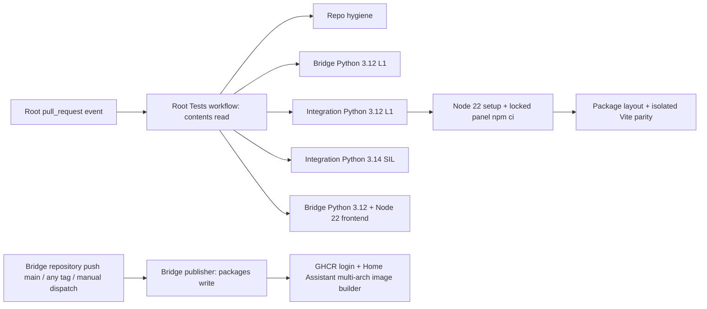

# Phase 29: PR-Safe Root, Bridge & Integration CI - Research

**Researched:** 2026-10-28  
**Domain:** GitHub Actions pull-request validation across the root repository and nested repositories  
**Confidence:** MEDIUM

<user_constraints>
## User Constraints (from 29-CONTEXT.md)

### Implementation Decisions

#### Claude's Discretion
- This is an infrastructure phase; implementation choices should reuse existing workflow conventions and avoid application-code changes unless a CI blocker requires them.
- Use the repository's existing Node 22 CI convention for the panel validation job, and install the panel's locked dependencies so the Phase 28 parity test runs rather than skips.
- Keep pull-request validation separate from release/image-publishing workflows. Do not trigger or run a publishing workflow, push, deploy, or publish artifacts.
- Preserve the declared Python runtime split: Python 3.12 for client/unit gates and Python 3.14 for the pinned Home Assistant SIL gate.
- Do not stage or commit; do not make host, Core, playback, provider/session, or hardware changes.

### Specific Ideas

Make CI run the bundle parity test unconditionally by providing Node 22 and installing the panel lockfile. Preserve pull-request/push test workflows as non-publishing gates.

### Deferred Ideas (OUT OF SCOPE)

- Add-on/image/package publication, deployment, release-artifact upload, and go/no-go remain out of scope.
- Live Home Assistant/provider/playback, HA-shell accessibility, and reconnect hardware testing remain assigned to later authorized phases.
</user_constraints>

<phase_requirements>
## Phase Requirements

| ID | Description | Research Support |
|----|-------------|------------------|
| PRD-02 | "Root, bridge, and integration CI gates pass on their declared runtimes; pull-request validation can run without publishing add-on images or release artifacts." [VERIFIED: `.planning/REQUIREMENTS.md:51`] | Root-owned PR/push checks cover bridge and integration L1, integration SIL, and bridge frontend. Add Node 22 plus lockfile-based panel install before the existing package-layout test so exact bundle parity cannot skip. Keep read-only PR validation separate from the bridge repository's publisher and local push scripts. |
</phase_requirements>

## Project Constraints (from copilot-instructions.md)

No workspace-root `copilot-instructions.md` was found in the repository. The active project constraints are the Phase 29 context above and `.planning/STATE.md`: current focus is Phase 29; do not stage or commit; publication, deployment, host/Core changes, playback, provider/session work, and hardware tests are not authorized. [VERIFIED: workspace file search; `.planning/STATE.md:101`; `.planning/phases/29-pr-safe-root-bridge-integration-ci/29-CONTEXT.md:17-21,46-49`]

## Summary

The checked-in root workflow is `.github/workflows/tests.yml`; it is the PR validation orchestrator for bridge and integration submodules. Its triggers are `push` to `main`, `pull_request`, and `workflow_dispatch`, and its explicit workflow permission is `contents: read`. Its jobs are repository hygiene, bridge L1, integration L1, integration SIL, and bridge frontend. The integration panel parity check is already included indirectly in integration L1 through `tests/test_package_layout.py`, but its Node/Vite/TypeScript guard skips it when Node/npm or installed Vite/TypeScript files are absent. [VERIFIED: `.github/workflows/tests.yml:3-13,14-137`; `modules/integration/tests/test_package_layout.py:141-171`]

The bridge directory is a separate Git repository (`BL-HAOS-Bridge`) with its own `.github/workflows/builder.yaml`; this workflow is not part of root PR execution merely because the root workflow checks out submodules. It is publication-capable: its trigger is `push` to `main`, any tag, or manual dispatch; it grants `packages: write`, logs into GHCR, and invokes Home Assistant Builder for a three-architecture matrix. The integration directory is also a separate Git repository (`BL-HAOS-Integration`); no workflow file was found in its local checkout and the public Actions API returned zero runs. That observation does not establish that no workflow could be configured elsewhere. [VERIFIED: `modules/bridge/.github/workflows/builder.yaml:3-13,57-105`; `modules/bridge/scripts/build-and-push.ps1:57-75`; local repository `rev-parse`/remote checks; GitHub Actions API checked 2026-10-28]

**Primary recommendation:** Keep PR checks in the root workflow and make the existing integration package-layout execution provision Node 22 and run `npm ci --ignore-scripts` against `modules/integration/panel_ui/package-lock.json` first. Retain the Python 3.12 L1 / Python 3.14 SIL split. Do not add a PR trigger, call, or dependency on the nested bridge publisher, and do not change its publication permissions or invoke its scripts as part of this phase. [VERIFIED: `.planning/phases/29-pr-safe-root-bridge-integration-ci/29-CONTEXT.md:17-21,31-42`; official npm and GitHub Actions documentation in Sources]

## Architectural Responsibility Map

| Capability | Primary Tier | Secondary Tier | Rationale |
|------------|-------------|----------------|-----------|
| PR event policy, token permissions, and job fan-out | GitHub Actions control plane | Ubuntu runner | Trigger and permission scope belong to the workflow repository; jobs execute on GitHub-hosted runners. [VERIFIED: `.github/workflows/tests.yml:3-13`; [CITED: GitHub Actions workflow syntax]] |
| Bridge backend and integration client regression | CI runner | Bridge / integration repositories | The root workflow checks out the nested sources and runs each module's tests in its own working directory. [VERIFIED: `.github/workflows/tests.yml:46-84`] |
| Home Assistant SIL | CI runner | Home Assistant integration runtime | The dedicated Python 3.14 job installs pinned Core/helper dependencies and executes the integration SIL suite. [VERIFIED: `.github/workflows/tests.yml:86-105`; `modules/integration/requirements-sil.txt:1-5`] |
| Panel source-to-package parity | CI runner | Browser/client build toolchain | Pytest controls an isolated Vite build and compares the output with the integration's tracked panel bundle. [VERIFIED: `modules/integration/tests/test_package_layout.py:141-171`] |
| Add-on image publication | Bridge repository release workflow | GHCR / Home Assistant Builder | The bridge publisher owns registry login and image build/push; it is separate from root PR validation. [VERIFIED: `modules/bridge/.github/workflows/builder.yaml:57-105`] |

## Workflow Ownership and Trigger Matrix

| Repository owner | Checked-in workflow | Trigger(s), verbatim values | Jobs / responsibility | Publication boundary |
|------------------|---------------------|---------------------------|-----------------------|----------------------|
| Root `BL_HAOS` | `.github/workflows/tests.yml` | ```yaml\non:\n  push:\n    branches:\n      - main\n  pull_request:\n  workflow_dispatch:\npermissions:\n  contents: read\n``` [VERIFIED: `.github/workflows/tests.yml:3-12`] | `repo-hygiene`; `bridge-unit`; `integration-unit`; `integration-sil`; `frontend`. Root PR and main-push checks exercise nested source trees after recursive submodule checkout. [VERIFIED: `.github/workflows/tests.yml:14-137`] | No `packages: write`, registry login, Docker push, release action, or artifact-upload step appears in this workflow. The `contents: read` declaration leaves unspecified token scopes at `none` under GitHub's permission rules. [VERIFIED: complete `.github/workflows/tests.yml`; [CITED: GitHub Actions permissions documentation]] |
| Nested bridge `BL-HAOS-Bridge` | `modules/bridge/.github/workflows/builder.yaml` | ```yaml\non:\n  push:\n    branches:\n      - main\n    tags:\n      - "*"\n  workflow_dispatch:\npermissions:\n  contents: read\n  packages: write\n``` [VERIFIED: `modules/bridge/.github/workflows/builder.yaml:3-14`] | `release-gates` then matrix `build` for `aarch64`, `amd64`, and `armv7`; `build` has `needs: release-gates`. [VERIFIED: `modules/bridge/.github/workflows/builder.yaml:16-105`] | This is intentionally outside PR validation but is not harmless: a push to bridge `main` (including a merge commit), any tag, or manual dispatch can enter the publisher. On a successful release-gates job it logs into GHCR and invokes Home Assistant Builder. [VERIFIED: same workflow; [CITED: GitHub Actions trigger and permission docs]] |
| Nested integration `BL-HAOS-Integration` | No workflow file found in the inspected local checkout; public Actions API returned `total_count: 0` | No trigger can be stated from inspected evidence. | Root `.github/workflows/tests.yml` currently runs integration unit/package-layout and SIL jobs against the checked-out module. [VERIFIED: `.github/workflows/tests.yml:66-105`] | Do not infer an integration-owned workflow or claim none can exist outside the inspected evidence. [VERIFIED: local workflow file search; public Actions API, 2026-10-28] |

The two nested module directories resolve to their own Git roots and remotes, rather than to the root `BL_HAOS` Git root. Root CI's `submodules: recursive` is source checkout, not a workflow invocation. GitHub workflow files are stored under the workflow-owning repository's `.github/workflows` directory and listen to events in that repository. [VERIFIED: local `git -C modules/bridge/modules/integration rev-parse --show-toplevel` and remote checks; [CITED: GitHub Actions workflow syntax]]

## Declared Runtime Matrix

| Gate | Workflow runtime | Dependency contract | Evidence / boundary |
|------|-------------------|----------------------|---------------------|
| Root hygiene | `ubuntu-latest`; no Python or Node setup | Git-only checks | Tracked scratch/report/credential scan; non-publishing. [VERIFIED: `.github/workflows/tests.yml:14-44`] |
| Bridge L1 | Python `"3.12"` | `modules/bridge/backend/requirements-test.txt` includes pytest 9.0.3 and pytest-asyncio 1.4.0 plus bridge runtime/test dependencies | Run `python -m pytest tests -q` from `modules/bridge`. [VERIFIED: `.github/workflows/tests.yml:46-64`; `modules/bridge/backend/requirements-test.txt:1-7`] |
| Integration client L1 | Python `"3.12"` | Workflow installs `aiohttp pytest pytest-asyncio voluptuous`; test command includes `tests/unit` and `tests/test_package_layout.py` | This job currently has no Node setup or panel npm install, so parity can skip. [VERIFIED: `.github/workflows/tests.yml:66-84`; parity guard at `modules/integration/tests/test_package_layout.py:144-150`] |
| Integration SIL L2 | Python `"3.14"` | `pytest-homeassistant-custom-component==0.13.374`, `homeassistant==2026.10.3`, `aiohttp==3.14.5`, `pytest==9.0.3` | Separate `integration-sil` job runs `tests/test_ha_integration_sil.py`; keep distinct from stubbed client units. [VERIFIED: `.github/workflows/tests.yml:86-105`; `modules/integration/requirements-sil.txt:1-5`] |
| Bridge frontend L3 | Python `"3.12"` and Node `"22"` | Bridge UI uses `npm ci --ignore-scripts`; Vitest/build/Playwright | Existing Node 22 convention to reuse; this is the bridge UI, not the integration panel. [VERIFIED: `.github/workflows/tests.yml:108-137`] |
| Nested bridge release gates | Python `"3.12"`; Node is not explicitly set in this workflow | `npm ci --prefix web_ui --ignore-scripts` | Not a PR job. Do not silently treat runner-default Node as a declared version or fold this publisher into PR validation. [VERIFIED: `modules/bridge/.github/workflows/builder.yaml:16-56`] |
| Integration panel parity | Required Node `22` per locked Phase 29 decision; npm is supplied by setup-node/runner, not separately pinned in the workflow | Existing `package.json` and `package-lock.json`, lockfileVersion `3`; no new direct dependency required | Local shell observed Node `v24.19.0`, npm `11.17.0`, Python `3.14.7`; these are diagnostic environment versions, not CI pins. [VERIFIED: `modules/integration/panel_ui/package.json:1-32`; `package-lock.json:1-8`; local version commands] |

The local panel manifest's relevant values are verbatim: `"build": "tsc && vite build"`, `"test": "vitest run"`, React/React DOM `"18.2.0"`, TypeScript `"5.2.2"`, Vite `"7.3.7"`, Vitest `"5.0.4"`. [VERIFIED: `modules/integration/panel_ui/package.json:7-31`]

## Standard Stack

### Core

| Library / tool | Version | Purpose | Why standard |
|----------------|---------|---------|--------------|
| `actions/checkout` | `v5` | Checkout root and recursive module sources | Existing workflow convention. [VERIFIED: `.github/workflows/tests.yml:32,52,72,92,115`] |
| `actions/setup-python` | `v6` | Explicit Python runtimes | Existing workflow convention. [VERIFIED: `.github/workflows/tests.yml:56,76,96,119`] |
| `actions/setup-node` | `v5`, Node `22` | Explicit panel build runtime | Existing bridge frontend convention and locked Phase 29 choice. [VERIFIED: `.github/workflows/tests.yml:123-125`; `29-CONTEXT.md:18,35`] |
| pytest | `9.0.3` in SIL; bridge requirements pin `9.0.3` | Backend, client, package-layout, and SIL tests | Existing module test framework. [VERIFIED: `modules/bridge/backend/requirements-test.txt:2-7`; `modules/integration/requirements-sil.txt:1-5`] |
| npm `ci` | npm version runner-provided; lockfileVersion `3` | Reproducible, manifest-consistent panel dependency install | npm documents `ci` for automation, requires a lockfile, fails on manifest/lock drift, and does not rewrite either manifest. [CITED: `https://docs.npmjs.com/cli/v11/commands/npm-ci`; `modules/integration/panel_ui/package-lock.json:1-8`] |

### Supporting

| Library | Version | Purpose | When to use |
|---------|---------|---------|-------------|
| TypeScript | `5.2.2` | Typecheck panel before Vite bundle | Existing `build` script. [VERIFIED: `modules/integration/panel_ui/package.json:7,27-31`] |
| Vite | `7.3.7` | Build panel module into a unique pytest temporary directory | Exact source-to-bundle parity. [VERIFIED: `modules/integration/panel_ui/package.json:7,27-31`; `modules/integration/tests/test_package_layout.py:152-171`] |
| Vitest | `5.0.4` | Panel source unit suite | Add only if the plan deliberately broadens the current parity task; it is not currently a root workflow job for the integration panel. [VERIFIED: `modules/integration/panel_ui/package.json:7-8,27-31`; complete `.github/workflows/tests.yml`] |

**Install / test commands:**

```bash
# From repository root
npm ci --prefix modules/integration/panel_ui --ignore-scripts
PYTEST_DISABLE_PLUGIN_AUTOLOAD=1 python -m pytest modules/integration/tests/test_package_layout.py::test_panel_bundle_matches_fresh_build -q
```

`npm ci --ignore-scripts` avoids dependency lifecycle scripts during installation; the parity test explicitly runs the package's named `build` script (`tsc && vite build`) into `tmp_path`, and compares the fresh bundle byte-for-byte. The existing test directory checks `node`, npm, Vite, and TypeScript and calls `pytest.skip` when any is absent. Add a CI preflight or equivalent job assertion so missing tools/packages cannot silently restore that skip. [CITED: npm `ci` documentation; VERIFIED: `modules/integration/panel_ui/package.json:7`; `modules/integration/tests/test_package_layout.py:144-171`]

### Alternatives Considered

| Instead of | Could use | Tradeoff |
|------------|-----------|----------|
| Provisioning Node in the existing integration client job | Separate `integration-panel-parity` job with Node 22, locked install, and focused pytest | Separate job gives clearer ownership but duplicates Python setup and risks leaving the current package-layout invocation as a skip-capable duplicate. Prefer the smallest change: set up Node and run `npm ci` before the existing integration L1 package-layout test. [ASSUMED recommendation based on current workflow structure] |
| `npm ci` | `npm install` | `npm ci` is the documented CI command and fails on lock mismatch rather than changing the lock; `npm install` can update the lock and weakens the read-only validation boundary. [CITED: npm `ci` documentation] |
| Root PR workflow | Triggering the nested builder on `pull_request` | Builder has `packages: write`, GHCR login, and image publication. Keep the current root read-only PR path separate. [VERIFIED: root and bridge workflow files; [CITED: GitHub permissions docs]] |

## Package Legitimacy Audit

The phase adds no package name or dependency version; it reuses the already tracked panel manifest and lockfile. The legitimacy scan flagged several installed direct dependencies as `SUS` only due to the heuristic registry signal `too-new`. This research reviewed locked and registry versions, source repositories, adoption counts, and lifecycle metadata: versions match, sources are canonical, download counts are high, and no relevant direct install scripts were identified. Disposition: keep all existing locked versions and use `npm ci --ignore-scripts`; no package/version/lockfile change or additional human checkpoint is required. [VERIFIED: `package.json` / `package-lock.json`; `gsd-tools query package-legitimacy check`; npm registry `npm view` results, 2026-10-28]

| Package | Registry | Locked / registry version | Latest published signal | Weekly downloads | Source repo | Verdict | Disposition |
|---------|----------|--------------------------|------------------------|-----------------|-------------|---------|-------------|
| `lucide-react` | npm | `0.344.0` / `0.344.0` | 2026-10-27 | 89,923,003 | `github.com/lucide-icons/lucide` | SUS: too-new | Reviewed; retain lock; no version change |
| `react` | npm | `18.2.0` / `18.2.0` | 2026-10-14 | 165,732,882 | `github.com/react/react` | SUS: too-new | Reviewed; retain lock; no version change |
| `react-dom` | npm | `18.2.0` / `18.2.0` | 2026-10-14 | 155,665,230 | `github.com/react/react` | SUS: too-new | Reviewed; retain lock; no version change |
| `@playwright/test` | npm | `1.63.0` / `1.63.0` | 2026-10-14 | 69,157,992 | `github.com/microsoft/playwright` | SUS: too-new | Reviewed; retain lock; no version change |
| `@testing-library/jest-dom` | npm | `6.9.1` / `6.9.1` | 2026-08-09 | 62,419,109 | `github.com/testing-library/jest-dom` | OK | Existing lock entry; approved |
| `@testing-library/react` | npm | `16.3.3` / `16.3.3` | 2026-08-27 | 60,415,911 | `github.com/testing-library/react-testing-library` | OK | Existing lock entry; approved |
| `@testing-library/user-event` | npm | `14.6.7` / `14.6.7` | 2026-10-13 | 53,505,162 | `github.com/testing-library/user-event` | SUS: too-new | Reviewed; retain lock; no version change |
| `@types/react` | npm | `18.2.66` / `18.2.66` | 2026-09-09 | 149,013,762 | `github.com/DefinitelyTyped/DefinitelyTyped` | OK | Existing lock entry; approved |
| `@types/react-dom` | npm | `18.2.22` / `18.2.22` | 2026-09-09 | 127,180,405 | `github.com/DefinitelyTyped/DefinitelyTyped` | OK | Existing lock entry; approved |
| `@vitejs/plugin-react` | npm | `4.7.0` / `4.7.0` | 2026-10-05 | 82,827,925 | `github.com/vitejs/vite-plugin-react` | SUS: too-new | Reviewed; retain lock; no version change |
| `jsdom` | npm | `25.0.1` / `25.0.1` | 2026-10-15 | 99,748,201 | `github.com/jsdom/jsdom` | SUS: too-new | Reviewed; retain lock; no version change |
| `typescript` | npm | `5.2.2` / `5.2.2` | 2026-07-08 | 267,244,286 | `github.com/microsoft/TypeScript` | OK | Existing lock entry; approved |
| `vite` | npm | `7.3.7` / `7.3.7` | 2026-10-21 | 171,580,460 | `github.com/vitejs/vite` | SUS: too-new | Reviewed; retain lock; no version change |
| `vitest` | npm | `5.0.4` / `5.0.4` | 2026-10-15 | 113,841,041 | `github.com/vitest-dev/vitest` | SUS: too-new | Reviewed; retain lock; no version change |

**Packages removed due to SLOP verdict:** none.  
**Packages flagged as suspicious SUS:** `lucide-react`, `react`, `react-dom`, `@playwright/test`, `@testing-library/user-event`, `@vitejs/plugin-react`, `jsdom`, `vite`, `vitest`. The heuristic result was reviewed against the evidence above; retain these existing locked entries unchanged and do not upgrade them as part of this phase.

## Current Online and Local CI Evidence

### Online

| Repository / workflow | Latest observed run | Result | Phase 29 relevance |
|-----------------------|---------------------|--------|--------------------|
| Root `BL_HAOS` / `Tests` | Run `40623960810`, push event to `main`, 2026-10-28 02:57 UTC, commit `ec733086da571253e01fe1e8ebc2d42dc44dbfe2` | Overall failed. `Integration client unit (L1)` failed at `Run client unit tests` with exit 2; `Bridge unit / API (L1)` failed at `Run bridge regression suite` with exit 1. `repo-hygiene`, `Frontend unit + build + E2E (L3)`, and `HA integration SIL (L2)` passed. | This is the latest observed root run, but it is a push run, not a current PR-event run. It identifies failed job boundaries, not exact test causes. Unauthenticated annotations provide only the process exit codes; detailed logs are sign-in gated. Do not infer a root cause or claim a PR has run. [VERIFIED: [root run 40623960810](https://github.com/Mahmoud-Eltabakh/BL_HAOS/actions/runs/40623960810); jobs API checked 2026-10-28] |
| Nested bridge `BL-HAOS-Bridge` / `Build Add-on` | Run `40623949969`, push event, 2026-10-28 02:57 UTC, commit `db670e880e20ef97f93b4c1abb4469cb001e064a` | `Bridge release gates` failed at `Run bridge regression tests`; dependent matrix `Build ${{ matrix.arch }}` was skipped. No login/build/push steps ran in that run. | Separate publisher failure, not a PR-safe CI failure. Do not rerun or dispatch it. Exact failed assertion is not exposed by unauthenticated annotations. [VERIFIED: [bridge run 40623949969](https://github.com/Mahmoud-Eltabakh/BL-HAOS-Bridge/actions/runs/40623949969); jobs API checked 2026-10-28] |
| Nested integration `BL-HAOS-Integration` | Public Actions API returned zero workflow runs | No run result to report. | No current integration-owned online CI evidence is available from that API query; this does not prove a workflow is impossible or configured nowhere else. [VERIFIED: `https://api.github.com/repos/Mahmoud-Eltabakh/BL-HAOS-Integration/actions/runs?per_page=5`, checked 2026-10-28] |

GitHub's annotations also noted that `ubuntu-latest` was scheduled to migrate to Ubuntu 26 beginning 2026-10-19. Do not attribute either pytest failure to this runner transition without the protected step logs or a controlled reproduction. [VERIFIED: annotations on root run 40623960810; [CITED: GitHub runner-image migration notice linked in annotation]]

### Local

The current worktree diagnostic run from `modules/bridge` passed `357 passed, 1 skipped, 1 warning` under Python 3.14.7. The correctly scoped integration unit plus package-layout run passed `88 passed` under Python 3.14.7; the 11 package-layout tests included `test_panel_bundle_matches_fresh_build`, which ran rather than skipped. [VERIFIED: local commands run 2026-10-28 from module working directories]

These are useful current-worktree signals, not parity with CI's Python 3.12 L1 runtime. The latest recorded Phase 28 evidence also reports 73 panel Vitest tests, 11 package-layout tests with parity active, and 26 WSL panel-registration SIL tests passing. The September runtime report's native-Windows SIL `fcntl` failure is a known OS boundary, not a Linux GitHub Actions failure. [VERIFIED: `.planning/phases/28-package-panel-bundle-parity/28-VERIFICATION.md:39-52,68-80`; `runtime-validation-report.md:14-16,50-56`]

No local npm install, GitHub workflow dispatch, publisher run, push, staging, or commit was performed during this research. The root and nested worktrees already contain unrelated user changes; preserve them. [VERIFIED: initial `git status --short --branch`; task execution record; `.planning/STATE.md:101`]

## Architecture Patterns

### PR Validation Flow



The PR path must terminate at test/build assertions and contain no edge to the bridge publisher. The bridge builder remains a separate repository workflow. A post-merge push to bridge `main` is still a publisher trigger; therefore, this research proves PR-event checks are non-publishing, not that merging a change can never start the separately configured publisher. [VERIFIED: both workflow files; [CITED: GitHub Actions event and permissions docs]]

### Recommended Project Structure

```text
.github/workflows/tests.yml                  # Root PR/push/manual non-publishing gates
modules/bridge/.github/workflows/builder.yaml # Independent bridge release/image publisher
modules/bridge/scripts/build-and-push.ps1     # Explicit local GHCR buildx --push surface
modules/bridge/scripts/watch-and-build.ps1    # Watches sources, calls build-and-push.ps1
modules/integration/tests/test_package_layout.py # Isolated package parity assertion
modules/integration/panel_ui/package.json
modules/integration/panel_ui/package-lock.json
modules/integration/custom_components/bl_haos/panel_static/bl-haos-media-panel.js
```

These paths are the inspected CI, packaging, and image-publication surfaces; no application-code change is implied. [VERIFIED: local file search and opened source files]

### Pattern 1: Make package parity non-skippable in CI

**What:** In root `integration-unit`, use existing `actions/setup-node@v5` with `node-version: "22"`; run `npm ci --prefix panel_ui --ignore-scripts` from `modules/integration` before the existing pytest command. Keep the Python 3.12 unit dependencies and existing `tests/unit tests/test_package_layout.py` selection. Add a preflight that fails if Node/npm or `panel_ui/node_modules/{vite,typescript}/package.json` are missing, so pytest's defensive skip cannot disguise broken CI setup. [RECOMMENDED: `29-CONTEXT.md:18,35`; `tests.yml:66-84`; `test_package_layout.py:144-150`]

**Why:** The test's direct source values are `"build": "tsc && vite build"`, `"vite": "7.3.7"`, and `"typescript": "5.2.2"`; its skip condition is `if node is None or npm is None or not vite_package.is_file() or not typescript_package.is_file():`. npm `ci` installs from the existing package lock and fails on lock/manifest drift rather than rewriting the manifests. [VERIFIED: `modules/integration/panel_ui/package.json:7,27-31`; `modules/integration/tests/test_package_layout.py:144-150`; [CITED: npm `ci` docs]]

**Output safety:** The parity test's `build_dir` is `tmp_path / "panel-build"`; it invokes `npm --prefix <panel> run build -- --outDir <temporary-dir>`, checks exactly the expected JS file, and calls `filecmp.cmp(..., shallow=False)`. Do not replace this with a normal build to the tracked `panel_static` directory as the test precondition. [VERIFIED: `modules/integration/tests/test_package_layout.py:152-171`; Phase 28 verification `28-VERIFICATION.md:39-50`]

### Anti-Patterns to Avoid

- **Treating a green Python-only package test as parity:** absent Node/Vite/TypeScript yields a skip; provision and preflight the exact toolchain. [VERIFIED: `test_package_layout.py:144-150`]
- **Running normal Vite build before comparison:** it can replace the tracked output and erase the evidence of drift; parity already isolates output in pytest `tmp_path`. [VERIFIED: `test_package_layout.py:152-171`; `modules/integration/panel_ui/package.json:7`]
- **Making the publisher a PR dependency or adding `pull_request` to `builder.yaml`:** that file has `packages: write` and the GHCR/Home Assistant Builder publication path. [VERIFIED: `modules/bridge/.github/workflows/builder.yaml:13,57-105`]
- **Using `pull_request_target` for source tests:** GitHub documents this trigger as having read/write repository token access even for public forks; ordinary `pull_request` and minimal permissions are the safer fit. [CITED: `https://docs.github.com/en/actions/writing-workflows/workflow-syntax-for-github-actions#permissions`]
- **Using `npm install`, `npm publish`, `docker buildx build --push`, or the watch script in PR verification:** package install may rewrite locks; the image script explicitly pushes to GHCR and the watch script invokes it. [CITED: npm `ci` docs; VERIFIED: `modules/bridge/scripts/build-and-push.ps1:57-75`; `watch-and-build.ps1:8-10,46-54`]
- **Calling old runtime-only Windows SIL failure a current CI failure:** local history says Home Assistant Core imports `fcntl` on Windows; the supported CI/SIL runner is Linux and the latest observed online L2 job passed. [VERIFIED: `runtime-validation-report.md:50-56`; `.github/workflows/tests.yml:86-105`; root run 40623960810]

## Don't Hand-Roll

| Problem | Don't build | Use instead | Why |
|---------|-------------|-------------|-----|
| Reproducible npm install | Custom dependency copy/sync script or `npm install` in CI | `npm ci --ignore-scripts` with the tracked `package-lock.json` | Official npm behavior enforces lock consistency and does not rewrite package manifests; `--ignore-scripts` prevents install lifecycle scripts. [CITED: npm `ci` docs] |
| Panel bundle drift check | Marker-only checks or a custom minifier | Existing pytest/Vite temporary-output build and exact byte comparison | It already asserts one output file and uses byte equality against the tracked package. [VERIFIED: `test_package_layout.py:141-171`] |
| CI/release boundary | Duplicated release workflow or conditional image build in PR workflow | Existing root `tests.yml` for PR checks; keep bridge builder and build scripts separate | Root's token is read-only and the publisher is a distinct, write-permission workflow. [VERIFIED: workflow files; [CITED: GitHub permissions docs]] |

**Key insight:** “PR-safe” is demonstrated by the PR workflow's event, granted token scopes, and complete step list, not by a green test result alone. The bridge publisher remains a distinct post-merge/manual/tag path; its existence and trigger must remain visible in the acceptance evidence. [VERIFIED: workflow source; [CITED: GitHub Actions permissions documentation]]

## Risks and Rollback-Safe Recommendations

- Keep workflow edits limited to root `tests.yml`; preserve existing bridge/integration submodule refs and all user changes. Do not edit the nested publisher or local scripts for this requirement unless a later explicit scope says otherwise. [RECOMMENDED: Phase 29 context and current dirty worktree]
- Do not run `modules/bridge/scripts/build-and-push.ps1`, `watch-and-build.ps1`, the nested builder workflow, a tag/push, or any package/release publication command. `build-and-push.ps1` includes `docker buildx build --push`; the watcher calls that script after file changes. [VERIFIED: scripts cited above]
- Because bridge builder `push: main` can publish after a merge, PR approval should require only root non-publishing checks; retain the separately governed main/tag publisher behavior and do not claim a merge is publication-free. No change to release authorization is proposed here. [VERIFIED: builder trigger and publish steps]
- If a new root PR gate fails, retain the failing check/log and fix only the relevant test or workflow step. A workflow-only rollback must not leave the parity test silently skippable on the accepted PR path; re-establish the Node/install preflight before marking PRD-02 done. Do not roll back or regenerate `panel_static` to make parity pass. [RECOMMENDED: test isolation and current requirement]
- Pinning `ubuntu-latest` to a dated runner image is a possible reproducibility choice, but the latest failure annotations do not attribute failures to the upcoming Ubuntu 26 migration. Do not combine a runner-image migration with this focused Node/parity change without evidence. [VERIFIED: latest run annotation; [CITED: runner-image notice]]
- Current root and nested repositories contain pre-existing modifications. Avoid cleanup, reset, staging, commit, and generated-bundle writes. The only intended file from this research phase is this document. [VERIFIED: initial worktree status; `.planning/STATE.md:101`]

## Project Constraints (from repository and phase context)

- Node 22 is the locked panel CI runtime; install the panel's existing locked npm graph so parity runs instead of skipping. [VERIFIED: `29-CONTEXT.md:18,49`]
- Python 3.12 remains the L1 client/unit runtime; Python 3.14 remains the pinned Home Assistant SIL runtime. [VERIFIED: `29-CONTEXT.md:20,42`; `tests.yml:56-105`]
- Keep PR validation separate from image/package/release publication; no publisher invocation, push, deploy, staging, or commit. [VERIFIED: `29-CONTEXT.md:19-21`; `.planning/config.json` has `"commit_docs": false`; `.planning/STATE.md:101`]
- No host, Core restart, playback, provider/session, or hardware action belongs to this phase. [VERIFIED: `29-CONTEXT.md:21,46-49`]

## Assumptions Log

| # | Claim | Section | Risk if wrong |
|---|-------|---------|---------------|
| A1 | A CI preflight for Node/npm/Vite/TypeScript plus `npm ci` is sufficient to make the existing defensive parity skip unreachable on the Ubuntu runner. | Pattern 1 | If a path or package resolution differs, CI could still skip; the preflight and focused test result must be inspected. |
| A2 | A single `integration-unit` Node setup is preferable to a new dedicated integration-panel job because the package-layout suite already runs there. | Alternatives Considered | If ownership visibility or runtime isolation is more important, a separate job may be clearer but must not leave a duplicate skip-only path. |
| A3 | The latest public root and bridge workflow runs are the relevant online baseline as of this research date. | Current Online and Local CI Evidence | They are push events, not proof of a current PR run; a new API observation is needed at planning/execution time. |

## Research Questions and Dispositions

1. **What caused the latest online root L1 failures? — DEFERRED**
   - What we know: integration unit pytest exited 2 and bridge pytest exited 1 in run `40623960810`; the other root jobs passed.
   - What's unclear: unauthenticated check annotations expose only exit codes; detailed job logs are sign-in gated, and local current-worktree tests pass under Python 3.14.7 rather than CI Python 3.12.
   - Disposition: Cause remains unknown because authenticated logs are unavailable and no push/check run is authorized. Fresh local exact-runtime results are separate evidence; do not infer causes from exit codes.
2. **Does the integration repository have an Actions workflow not present in the inspected checkout? — RESOLVED FOR THIS PHASE**
   - What we know: no local workflow file was found and the public API returned zero runs.
   - What's unclear: zero runs is not proof that no disabled, private, or externally configured workflow exists.
   - Disposition: Root `tests.yml` is the only observed CI owner in the inspected checkout; no separate integration workflow is added without evidence.
3. **Should the test workflow pin `ubuntu-latest`? — RESOLVED: NO PIN**
   - What we know: an annotation announced the Ubuntu 26 migration; failure annotations do not tie failures to that change.
   - What's unclear: whether a fixed runner image is part of PRD-02's reproducibility bar.
   - Disposition: Leave `ubuntu-latest` unchanged because no observed failure is attributed to the migration; runner-image reproducibility is not required by this focused phase.

## Environment Availability

| Dependency | Required by | Available | Version | Fallback |
|------------|-------------|-----------|---------|----------|
| Python | Local diagnostic suites | Yes | 3.14.7 | GitHub jobs explicitly install 3.12 or 3.14 as declared. |
| Node.js | Local parity test | Yes | 24.19.0 | CI must use locked Node 22 via existing setup-node action. |
| npm | Panel package graph | Yes | 11.17.0 | `npm ci` from the tracked lockfile in CI. |
| Panel Vite/TypeScript dependencies | Isolated parity | Present in local test environment; parity test did not skip | Manifest/lock versions shown above | CI install plus preflight; do not accept skip. |
| Docker / GHCR credentials | Bridge image publication only | Not required for PR validation; no publisher run was made | — | Exclude from PR checks. |
| GitHub CLI authentication | Online logs | `gh` unauthenticated; public run/check API available | — | Use authenticated read-only run-log access when available; do not dispatch/rerun workflows. |

**Missing dependencies with no fallback:** None for the planned non-publishing PR checks. The user-facing host, playback, provider/session, and hardware checks are explicitly out of scope, not CI dependencies. [VERIFIED: Phase 29 context; local checks and online workflow definitions]

## Validation Architecture

Nyquist validation is enabled in `.planning/config.json` (`"nyquist_validation": true`). Security enforcement is enabled (`"security_enforcement": true`) at ASVS level 1. [VERIFIED: `.planning/config.json:24,45-50`]

### Test Framework

| Property | Value |
|----------|-------|
| Framework | pytest 9.0.3; pytest-asyncio 1.4.0; Vitest 5.0.4 for existing frontend suites |
| Config files | `modules/bridge/pytest.ini`; `modules/integration/pytest.ini`; `modules/integration/panel_ui/vitest.config.ts` |
| Quick bridge run | `cd modules/bridge; python -m pytest tests -q` with `PYTEST_DISABLE_PLUGIN_AUTOLOAD=1` |
| Quick integration run | `cd modules/integration; python -m pytest tests/unit tests/test_package_layout.py -q -p asyncio --asyncio-mode=auto` |
| Focused parity run | `cd modules/integration; python -m pytest tests/test_package_layout.py::test_panel_bundle_matches_fresh_build -q` after Node 22, npm ci, and a missing-tool/package preflight |
| Integration SIL | `cd modules/integration; BLHAOS_RUN_SIL=1 python -m pytest tests/test_ha_integration_sil.py -q -p asyncio --asyncio-mode=auto` under Python 3.14/Linux |
| Bridge frontend gate | From `modules/bridge/web_ui`: `npm ci --ignore-scripts`, `npm test`, `npm run build`, and `npm run test:e2e` after Chromium installation |

Commands are module-local by design: bridge and integration tests read relative paths. Running bridge tests from repository root produced false `FileNotFoundError` failures; rerun from `modules/bridge`, matching the workflow's `working-directory`. [VERIFIED: local invocation and correctly scoped 357-pass run; `.github/workflows/tests.yml:48-50`]

### Phase Requirements -> Test Map

| Req ID | Behavior | Test type | Automated command | File exists? |
|--------|----------|-----------|-------------------|-------------|
| PRD-02 | Root hygiene rejects tracked scratch/report/credential files | CI hygiene | Root `repo-hygiene` steps in `.github/workflows/tests.yml` | Yes |
| PRD-02 | Bridge L1 regressions pass on Python 3.12 | Unit/API | `cd modules/bridge && python -m pytest tests -q` | Yes; current local diagnostic passed on 3.14.7, not the declared runtime |
| PRD-02 | Integration client and package layout pass on Python 3.12 | Unit/package | `cd modules/integration && python -m pytest tests/unit tests/test_package_layout.py -q -p asyncio --asyncio-mode=auto` | Yes; current local diagnostic passed on 3.14.7 |
| PRD-02 | Fresh integration-panel build matches tracked package bytes and does not skip in CI | Build/parity | `cd modules/integration && python -m pytest tests/test_package_layout.py::test_panel_bundle_matches_fresh_build -q` after Node 22 + npm ci + preflight | Yes; currently skip-capable; local run passed without skip |
| PRD-02 | Pinned Home Assistant Core SIL passes on Python 3.14 | Integration SIL | `cd modules/integration && BLHAOS_RUN_SIL=1 python -m pytest tests/test_ha_integration_sil.py -q -p asyncio --asyncio-mode=auto` | Yes; latest online root job passed |
| PRD-02 | Bridge frontend unit/build/demo E2E pass on Node 22 | Frontend | `cd modules/bridge/web_ui && npm test && npm run build && npm run test:e2e` after existing install/browser setup | Yes; latest online root job passed |
| PRD-02 | PR validation cannot publish a package/image/release artifact | Workflow contract | Inspect trigger, permissions, and every step in root `tests.yml`; assert no publisher invocation or artifact upload | Yes; add/retain static workflow assertions if local CI conventions support them |

### Sampling Rate

- **Per workflow task:** Run the narrowest changed validation command; for panel CI wiring, require the parity test to report as executed, not skipped.
- **Per wave:** Run bridge L1, integration L1 plus parity, integration SIL, and bridge frontend L3 on their declared runtimes.
- **Phase gate:** Latest required PR checks green on Node 22 / Python 3.12 / Python 3.14 as specified; workflow review confirms PR token is read-only and no publication path executes. Do not treat a push-only main run as evidence of a current PR event.

### Wave 0 Gaps

- [ ] Add Node 22 setup and `npm ci --ignore-scripts` for `modules/integration/panel_ui` before integration package-layout tests.
- [ ] Add a CI preflight or strict test contract so missing Node/npm/Vite/TypeScript cannot turn the parity requirement into a pytest skip.
- [ ] Obtain authenticated details for root run `40623960810` failed L1 steps, or record explicitly that the prior run's cause cannot be established from available evidence.
- [ ] Add a non-publishing workflow-contract assertion only if a suitable existing static-test surface is identified; do not create a publisher test that dispatches the nested workflow.

## Security Domain

Security enforcement is enabled at ASVS level 1. The primary Phase 29 controls are workflow permissions and the separation between untrusted PR validation and trusted publication triggers. [VERIFIED: `.planning/config.json:45-50`; workflow files]

### Applicable ASVS Categories

| ASVS category | Applies | Standard control |
|---------------|---------|------------------|
| V2 Authentication | Limited | No user auth flow in CI. GHCR credentials are not needed in root PR jobs. |
| V3 Session Management | No | No Home Assistant or provider session is used by PR checks. |
| V4 Access Control | Yes | Root workflow declares `contents: read`; do not add `packages: write`, `id-token: write`, deployment, or release permissions. GitHub recommends least privilege. [CITED: official GitHub Actions permissions/security docs] |
| V5 Input Validation | Yes | Treat workflow inputs and PR source as untrusted; keep ordinary `pull_request`, avoid `pull_request_target`, and do not interpolate untrusted values into shell commands. |
| V6 Cryptography | Limited | No application cryptography changes; rely on GitHub token scope, npm lock integrity, and HTTPS registry access. |

### Known Threat Patterns for GitHub Actions CI

| Pattern | STRIDE | Standard mitigation |
|---------|--------|---------------------|
| PR workflow inherits broad token rights | Elevation of privilege | Explicit `contents: read`; unspecified scopes become none; keep `packages` absent. |
| PR source executes in a publisher job | Tampering / elevation | Separate PR workflow from push/tag/manual release workflow; no reusable call or dependency into builder. |
| Dependency lifecycle code runs during install | Execution / supply chain | Keep `npm ci --ignore-scripts`; explicitly invoke only the required local build command. |
| Test skips when build prerequisites are missing | Tampering / false assurance | Install locked dependencies and fail a preflight before pytest's skip guard can pass. |

## Sources

### Primary (HIGH/MEDIUM confidence)

- `.github/workflows/tests.yml` - Root triggers, least-privilege permission, Python/Node versions, job commands.
- `modules/bridge/.github/workflows/builder.yaml` - Separate bridge publisher triggers, packages permission, release-gate dependency, GHCR login, multi-arch builder.
- `modules/bridge/scripts/build-and-push.ps1`; `modules/bridge/scripts/watch-and-build.ps1` - Explicit local image push and watcher-to-publisher call.
- `modules/integration/tests/test_package_layout.py`; `modules/integration/panel_ui/package.json`; `modules/integration/panel_ui/package-lock.json` - Node/Vite skip guard, isolated parity build, locked dependencies and scripts.
- `.planning/phases/28-package-panel-bundle-parity/28-VERIFICATION.md`; `.planning/phases/28-package-panel-bundle-parity/28-VALIDATION.md` - Latest recorded local parity and SIL baseline.
- GitHub Actions public API root run `40623960810` and bridge run `40623949969`, queried 2026-10-28. Root run is a push event; exact pytest failure details remain unavailable in unauthenticated annotations.

### Official documentation

- npm CLI `npm ci`: [https://docs.npmjs.com/cli/v11/commands/npm-ci](https://docs.npmjs.com/cli/v11/commands/npm-ci) - Automation use, lockfile requirement, lock mismatch behavior, no manifest rewrite, `--ignore-scripts` behavior. [CITED]
- GitHub Actions workflow syntax: [https://docs.github.com/en/actions/writing-workflows/workflow-syntax-for-github-actions](https://docs.github.com/en/actions/writing-workflows/workflow-syntax-for-github-actions) - Workflow event triggers, permissions, and omitted scopes. [CITED]
- GitHub Actions security guidance: [https://docs.github.com/en/actions/reference/security/secure-use](https://docs.github.com/en/actions/reference/security/secure-use) - Least-privilege token recommendations. [CITED]
- `actions/setup-node`: [https://github.com/actions/setup-node](https://github.com/actions/setup-node) - Explicit `node-version`, supported major version syntax, monorepo cache lockfile path. [CITED]

## Metadata

**Confidence breakdown:**
- Workflow ownership and triggers: HIGH - source files opened; root and nested public run endpoints cross-checked.
- Declared runtime matrix: HIGH - workflow YAML and locked requirement/manifest sources read directly.
- Current failure causes: LOW - failed pytest step boundaries and exit codes verified, but underlying logs are sign-in gated and not inferred.
- Panel parity pattern: HIGH - current test implementation and lockfile read; current local test passed with parity active.
- Non-publication boundary: HIGH for root workflow source; builder is separately publication-capable and can run on main push/tag/manual dispatch.

**Research date:** 2026-10-28  
**Valid until:** 2026-11-27, or sooner if workflow triggers, Node/Python pins, submodule ownership, or GitHub Actions runner behavior changes.
